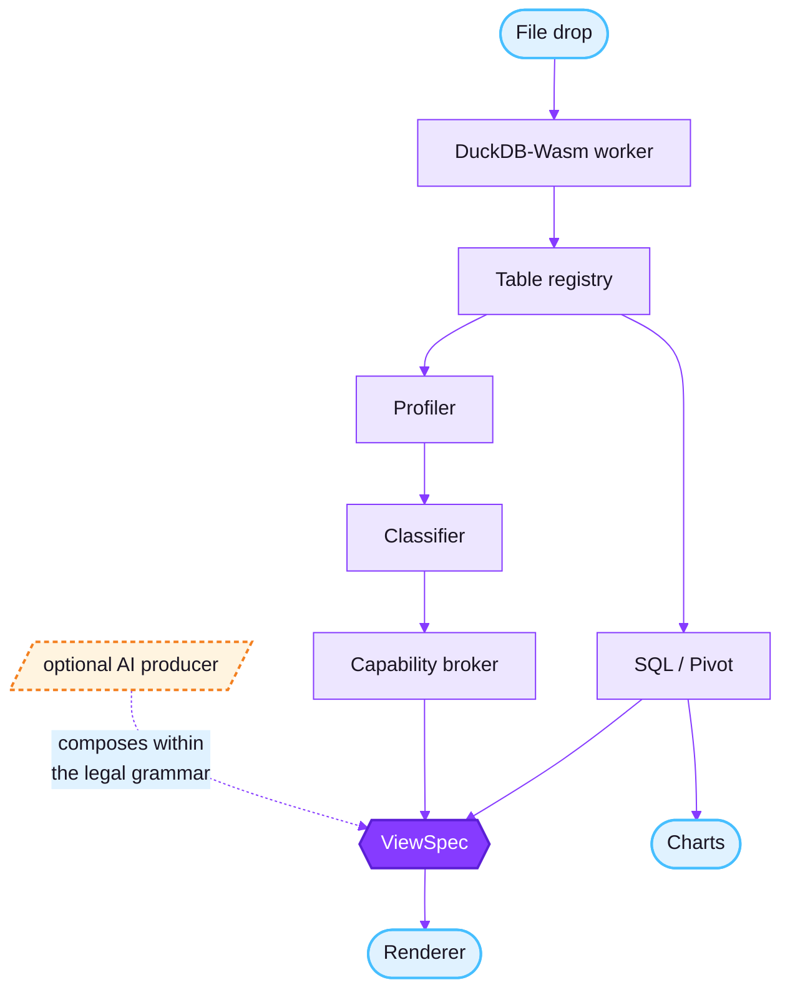

<div align="center">

<!--  -->

# DataScope

### **Drop a folder of data files into your browser and find out what you've been handed.**

<p>
  
  
  
</p>

<p>
  
  
  
  
  
  
  
</p>

</div>

<div align="center">

**`drop`** ⟶ **`Blueprint`** ⟶ **`ask or one-click task`** ⟶ **`answer`** ⟶ **`take it with you`**

</div>

---

DataScope is a browser-native analytics workspace. Files are read, parsed, profiled, queried
and charted entirely on the client a DuckDB-Wasm engine running in a web worker. Nothing is
uploaded. With AI switched off the app makes **no network requests at all** after load, which
you can verify in DevTools.

The headline capability is **structure understanding**, not chat: what tables you have, what
the columns actually mean, how they relate, and what's wrong with them. AI is a supporting
module you can turn off entirely.

> [!NOTE]
> The production build is a folder of static files. It runs from any static host or straight
> off your disk, with the network cable unplugged.

<br />

<div align="center">

[**What works today**](#what-works-today) &nbsp;·&nbsp;
[**Not built yet**](#not-built-yet) &nbsp;·&nbsp;
[**Quick start**](#quick-start) &nbsp;·&nbsp;
[**Architecture**](#architecture) &nbsp;·&nbsp;
[**Stack**](#stack) &nbsp;·&nbsp;
[**Privacy**](#privacy)

</div>

---

## What works today

<table>
<tr>
<td width="33%" valign="top">

### Ingest

CSV, TSV, Parquet, JSON, JSONL and ZIP archives. Drop a **whole folder** and each file
registers as its own named table, queryable across tables.

</td>
<td width="33%" valign="top">

### Understand

Summary statistics per column, a **semantic classifier** that infers what a column *is* beyond
its storage type, and a capability engine that gates the UI from the inferred schema.

</td>
<td width="33%" valign="top">

### Query

Monaco-backed SQL editor with schema-aware suggestions, a virtualized results grid, and a
**pivot / cross-tab builder** for people who don't want to write SQL.

</td>
</tr>
</table>

**Size is handled in tiers** a warning at 50MB, sampling at 100MB, and a clear refusal with
guidance above 300MB rather than a hung tab. XLSX is rejected with an explanatory modal
pointing at CSV export.

The **Blueprint** is the post-ingest landing view: a tiered one-screen read of the dataset with
a headline verdict, confidence-labeled facts, and ranked next actions that open the relevant
module *already pointed at the answer*.

A transformation layer records the generating SQL of derived tables, so the work is re-runnable.

### Visualize

Time-series, distribution, categorical and correlation charts plus a **Join Graph (beta)**:
foreign-key inference across a multi-table drop, every edge labeled with its evidence and
confidence rather than asserted as fact.

### AI optional, three modes

<div align="center">

| Mode | What it does | Network |
| :--- | :--- | :--- |
| **Local-only** | AI off. Every deterministic module still works. | **None** |
| **Local model** | WebLLM on WebGPU in a worker, model cached after first download. | Model download only |
| **API** | Workers AI, your own provider key, or a local Ollama endpoint one auto-detecting key/endpoint field. | Per request |

</div>

Natural-language questions become SQL through a staged pipeline with a **full client-side trace
you can inspect**. Keys are held in memory and passed through statelessly by default; opt-in
storage in an edge-held vault is explicit and deletable.

<details>
<summary><b>Edge surface</b> opt-in, separately deployed</summary>

<br />

A Cloudflare Worker exposing `/health`, `/ai-router`, `/cors-relay`, `/vault`, `/synthesis`,
`/persistence` and an MCP endpoint, with rate limiting via a Durable Object and content-free
operational counters.

**The client core never requires it.**

</details>

<details>
<summary><b>Eval harness</b> dev/CI only</summary>

<br />

A harness in [`eval/`](eval/) scoring NL→SQL and synthesis output against a labeled
ground-truth set over the bundled samples exec-rate, correctness, cost and repair-rate per
provider.

**Not shipped in the product runtime.**

</details>

---

## Not built yet

> [!WARNING]
> Fetching data from remote APIs, Parquet export and hosted save/share, the published
> profile-spec artifact, and the Studio arc (data-quality report, full relationship graph,
> semantic model and dbt export). ML modules are unscheduled.
>
> The empty `src/features/{export,ml,studio}` directories are placeholders for these.

---

## Quick start

Requires **Node 22** (see [`.nvmrc`](.nvmrc)).

```bash
make install     # npm install
make dev         # Vite dev server
make check       # lint + typecheck + tests
```

Open the dev server and drag a file in or start from the bundled samples in
[`public/samples/`](public/samples/):

<div align="center">

`titanic` &nbsp;·&nbsp; `weather` &nbsp;·&nbsp; `stock_prices` &nbsp;·&nbsp;
`product_reviews` &nbsp;·&nbsp; `ecommerce/` *(multi-table joins)*

</div>

<details open>
<summary><b>All commands</b></summary>

<br />

| Command | Does |
| :--- | :--- |
| `make dev` | Vite dev server with HMR |
| `make build` | Type-check and produce the static production build |
| `make lint` | oxlint |
| `make typecheck` | `tsc -b --noEmit` across app, edge and eval projects |
| `make test` | Vitest |
| `make check` | All three of the above |
| `npm run eval` | NL→SQL eval harness |
| `npm run edge:dev` | Wrangler dev server for the edge worker |
| `npm run edge:deploy:staging` | Deploy the worker to staging |
| `make docker-build` / `docker-run` | Dev/CI parity container **never** the production runtime |

</details>

---

## Architecture



### Four load-bearing seams

<table>
<tr><td width="22%" valign="top"><b><code>QueryEngine</code></b></td>
<td valign="top">Profiling, classification and insight generation are written against this
interface, <b>never against DuckDB-Wasm directly</b> so the engine is replaceable.</td></tr>

<tr><td valign="top"><b>Table registry</b></td>
<td valign="top">The session catalog over the engine. The engine executes; the registry owns
loaded and derived tables, their metadata, memory accounting and lifecycle.</td></tr>

<tr><td valign="top"><b><code>ViewSpec</code></b></td>
<td valign="top">The renderer consumes a versioned, validated, capability-gated layout artifact
and <b>never executes model output</b>. A deterministic producer paints first, <i>always</i>; an
AI producer can only compose within the grammar the broker declared legal, and any failure
degrades to the deterministic view.</td></tr>

<tr><td valign="top"><b>Structural facts</b></td>
<td valign="top">One model behind both the profile UI and the AI prompt's schema pruner. Facts
carry snapshot provenance and are <b>never</b> labeled permanent or verified.</td></tr>
</table>

> [!IMPORTANT]
> A standing constraint: every capability must produce or consume an **existing artifact**
> through an **existing interface**. No parallel end-to-end pipelines.

<details>
<summary><b>Repository layout</b></summary>

<br />

| Path | Contains |
| :--- | :--- |
| [`src/app`](src/app), [`src/components`](src/components) | Shell, theming, four capability-gated nav groups (DATA / EXPLORE / ANALYZE / OUTPUT) |
| [`src/features`](src/features) | Ingestion, profiling, SQL, charts, AI one directory per surface |
| [`src/services`](src/services) | Engine-facing logic: ingestion, profiling, SQL, charts, relationships, AI providers |
| [`src/stores`](src/stores) | Zustand stores datasets (the registry), query, settings |
| [`src/workers`](src/workers) | DuckDB and WebLLM web workers |
| [`src/types`](src/types) | Shared contracts dataset, schema, chart, viewspec, actions, producers |
| [`edge/`](edge/) | Cloudflare Worker: AI router, CORS relay, vault, synthesis, persistence, MCP, rate limiting |
| [`eval/`](eval/) | NL→SQL and synthesis eval harness (dev/CI only) |
| [`infra/`](infra/) | Terraform Cloudflare account resources and R2 lifecycle rules |
| [`_implementation/`](_implementation/) | Design and specification tree the source of truth for what gets built |

Terraform owns long-lived account resources; Wrangler owns worker code, bindings and secrets.
**Terraform never deploys worker code.**

</details>

---

## Stack

<div align="center">

**React 19** · **TypeScript 6** · **Vite 8** · **Zustand 5** · **DuckDB-Wasm 1.32** ·
**Apache Arrow 17** · **Monaco 0.55** · **Recharts 3.9** · **WebLLM 0.2.84** ·
**Tailwind 4** · **Vitest 4** · **oxlint** · **Wrangler 4** · **Terraform**

<br />


</div>

---

## Privacy

The local core is **free and works offline by construction**. Data rows leave the browser only
through an explicit, labeled action *you* take there is no silent fallback to the network and
no telemetry on the local path.

Operational counters on the edge path are numeric and content-free:

<div align="center">

**never prompts** &nbsp;·&nbsp; **never SQL** &nbsp;·&nbsp; **never your data**

</div>

Sharing, when it ships, defaults to **structure only no data rows included**, which is true by
construction rather than by policy. Redaction and suppression controls reduce re-identification
risk; they are never described as anonymizing data, and nothing here is a compliance claim.

---

<div align="center">

<sub>Licensed under **Apache-2.0** · Built to be inspected in DevTools</sub>

</div>
