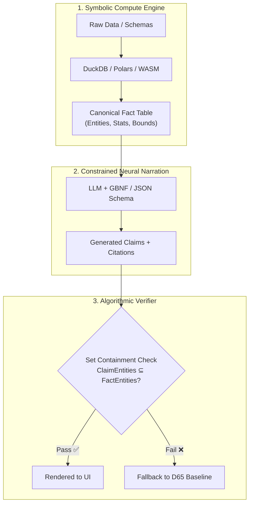

# AI for Data Analysis: Mastery Roadmap & Systems Architecture

> **Core Philosophy:** In AI for Data Analysis, LLMs should **never** perform raw calculation or make unverified freehand claims. Computation is 100% Symbolic (Deterministic Engine like DuckDB/Polars), Narration is Neural (LLMs), and Verification is 100% Algorithmic (Set Theory & Formal Grammars).

---

## 1. The 5 Pillars of Neuro-Symbolic AI Engineering

### Pillar 1: Constrained Generation & Formal Verification
- **Grammar-Guided Decoding (GBNF & JSON Schema):** Enforce state-machine token masking at inference time using `llama.cpp` GBNF grammars or Outlines/vLLM so the model physically cannot produce tokens violating the schema.
- **Static Set Containment & AST Validation:** Treat LLM outputs as code streams to be parsed into Abstract Syntax Trees (ASTs). Validate subset relationships ($\text{ClaimEntities} \subseteq \text{FactEntities}$) per clause.
- **Declarative LLM Programs (DSPy):** Treat LLM calls as compiled function signatures with assertion contracts rather than raw prompt strings.

### Pillar 2: Embedded Execution & Code-as-Reasoning Engines
- **In-Process Analytical Engines (DuckDB / Polars):** Calculate exact metrics, quantile sketches, and date ranges in-memory (C++/Rust/WASM) without sending raw data over the network.
- **Text-to-SQL & Code Sandboxing:** Have the LLM produce strict SQL or Polars code execution traces instead of attempting direct math in neural weights.
- **Visual Spec Generation (Vega-Lite):** Direct the LLM to output interactive visual specifications and filter states rather than freehand narrative claims.

### Pillar 3: Adversarial Evals & Mutational Testing
- **Synthetic Poison Vector Testing:** Build test suites specifically targeting the 4 core failure classes:
  - **F1 — Misattribution:** Swap column associations in facts and verify the validator rejects the claim.
  - **F2 — Invention:** Inject novel string tokens into context to check false-acceptance rates.
  - **F3 — World Knowledge Leakage:** Provide datasets (e.g., `titanic.csv`) missing specific metadata columns to ensure historical pre-training knowledge does not leak.
  - **F4 — Non-Determinism:** Monte Carlo temperature sampling ($N=10$) to measure output claim variance across runs.

### Pillar 4: Intent Framing & Interaction Design ("Offers, Not Claims")
- **Action-Oriented Contracts:** Frame AI outputs as *Offers* (suggested SQL queries, visualization options, data hypothesis tests) rather than assertive *Claims*. Offers carry zero risk of hallucinating facts.
- **Human-in-the-Loop Orchestration:** Allow users to approve and compile suggested AI actions directly into the workspace UI/UX.

### Pillar 5: Privacy-Preserving & Edge Execution
- **Zero Raw Data Over the Wire:** Extract abstract structural metadata locally; never send cell values or raw rows to external LLMs.
- **Fine-Tuned Small Language Models (SLMs):** Train 3B–8B parameter local models (Qwen 2.5, Llama 3.2 3B, Phi-3.5) specifically for Fact-to-Claim translation via Ollama / Cloudflare Workers AI / ONNX / WebGPU.

---

## 2. Essential Curriculum & Reading List

### The 3 Must-Read Books
1. ** *Crafting Interpreters* by Robert Nystrom**
   - *Why:* Teaches scanning, parsing, AST generation, and static analysis. Essential for treating LLM output as code to be compiled and verified against dataset schemas.
2. ** *Designing Data-Intensive Applications (DDIA)* by Martin Kleppmann**
   - *Why:* The definitive text on data engines, columnar storage, exactness vs. probabilistic sketches, and data transformation mechanics.
3. ** *Building LLM Applications for Production* by Chip Huyen**
   - *Why:* Deep dive into production LLM system design, evaluation harnesses, guardrails, latency optimization, and sampling mechanics.

### The 4 Essential Papers / Specs
1. **[GBNF Grammar Specification (`llama.cpp`)](https://github.com/ggerganov/llama.cpp/blob/master/grammars/README.md):** Formal syntax for context-free logit masking during token generation.
2. **[DSPy: Compiling Declarative Language Model Calls](https://arxiv.org/abs/2310.03714) (Stanford):** Framework for compiling language model pipelines with assertion checks.
3. **[Outlines: Guarantees for Neural Text Generation](https://arxiv.org/abs/2307.09702):** The mathematics of transforming regular expressions and JSON schemas into Finite State Machines (FSMs).
4. **[ReAct & PAL (Program-Aided Language Models)](https://arxiv.org/abs/2211.10435):** Interleaving reasoning with code execution environments.

---

## 3. Hands-on 3-Step Blueprint for DataScope

1. **Write a Hand-Rolled Validator:** Build a 50-line TypeScript parser that tokenizes generated text, extracts entity identifiers, and verifies set containment ($\text{ClaimEntities} \subseteq \text{FactEntities}$) without relying on external AI libraries.
2. **Build the F1–F4 Mutational Test Suite:** Create a script to run 5 synthetic datasets through Ollama ($N=5$ repeats), injecting poison vectors to guarantee 100% detection rate.
3. **Enforce the Symbolic vs. Neural Boundary:**
   - **Compute:** 100% DuckDB / Polars / WASM.
   - **Structure:** 100% GBNF / JSON Schema constraints.
   - **Narration:** LLM output validated via AST set-containment before UI rendering.

---

## 4. Career Alignment: AI Engineer & Forward Deployed Engineer (FDE) Roles

The architecture developed for DataScope translates directly to high-tier **AI Engineer (AIE)** and **Forward Deployed Engineer (FDE)** roles at enterprise AI companies (Palantir, OpenAI, Anthropic, Databricks, Scale AI, Snowflake):

| DataScope Architecture Capability | Industry Job Role & Function | Strategic Value |
| :--- | :--- | :--- |
| **Citation Binding & AST Verification** | **Deterministic Guardrails & Grounding** | Enables enterprise deployment in regulated sectors (finance, defense, healthcare) where zero-hallucination guarantees are mandatory. |
| **Local DuckDB Metadata / Zero Data Leaks** | **Privacy-Preserving & Edge AI Systems** | Satisfies strict HIPAA, SOC2, and private VPC deployment constraints. |
| **F1–F4 Mutational Eval Framework** | **Adversarial Red-Teaming & Production Evals** | Replaces informal prompt testing with statistical regression suites. |
| **Offers Not Claims Architecture** | **Human-in-the-Loop & Agentic Systems** | Turns AI into a verified action suggestion engine compiled into production user interfaces. |

### Interview Framing Strategy
- **Core Value Proposition:** Move beyond basic API wrapper development by treating LLM outputs as untrusted string streams requiring formal AST verification and deterministic query execution.
- **Key Positioning:** *"I design neuro-symbolic AI systems where calculation is handled deterministically in columnar engines, and LLM prose is validated via AST set containment prior to execution or UI rendering."*
