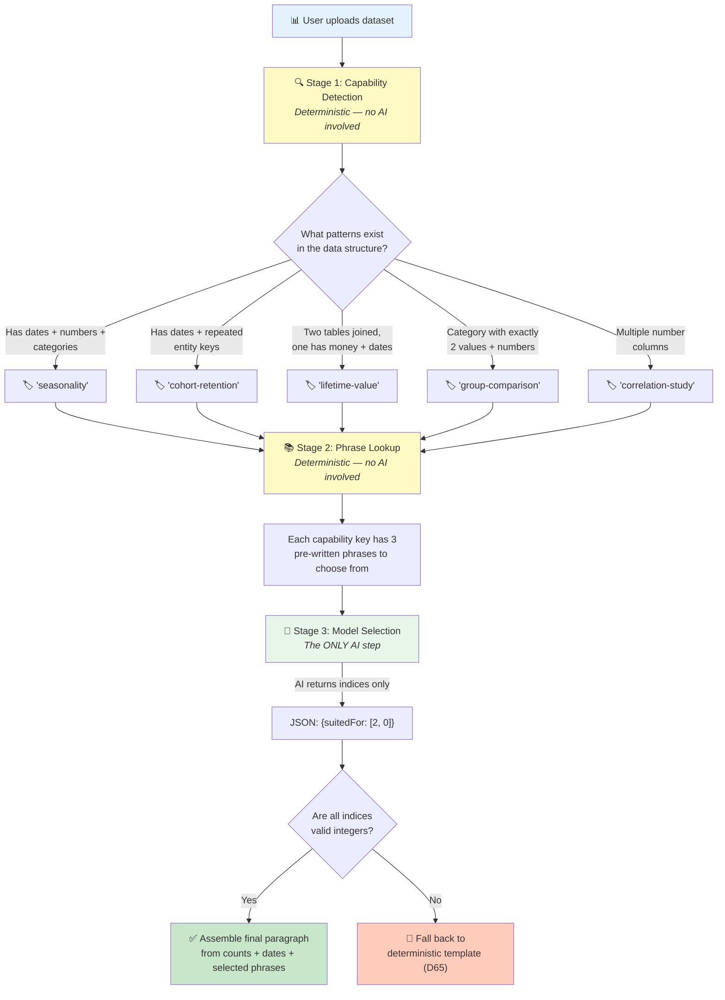
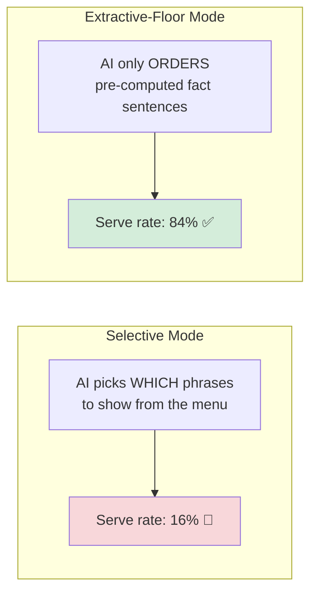

# 01 — Capability-Keyed Phrase Library — How It Works

## The Core Idea in One Sentence

Instead of letting the AI write whatever it wants about a dataset, **humans pre-write all the possible descriptions**, and the AI just **picks which ones to show**.

---

## Why This Should Work

The fabrications (F2: "Manchester", F3: "sank in April 1912") are things **the AI made up from scratch**. If the AI can only choose from a menu of pre-written, pre-vetted phrases, it literally cannot invent new content — the same way a multiple-choice test prevents you from writing fiction.

---

## How Data Flows Through the System



### Stage 1: Capability Detection (No AI)

The app looks at the **structure** of the data (column names, types, cardinalities, date ranges) and figures out what kinds of analysis the dataset is good for. For example:

- Does it have dates + numbers + categories? → Good for **seasonality analysis**
- Does it have two tables joined on a key with money columns? → Good for **lifetime value calculation**
- Does it have a 2-value category + number columns? → Good for **group comparison**

### Stage 2: Phrase Lookup (No AI)

Each detected capability maps to **3 pre-written phrases**. These were written by humans and reviewed once. Example for "lifetime-value":

- "estimating how much each customer is worth over time"
- "calculating customer lifetime value across purchase history"
- "measuring long-term revenue per customer"

### Stage 3: Model Selection (The Only AI Step)

The AI receives the detected capabilities and the candidate phrases, and returns **just index numbers** — not prose:

```json
{"suitedFor": [2, 0]}
```

This means "use phrase #2 for the first capability and phrase #0 for the second." If the AI returns anything other than valid in-range integers, it's rejected and the system falls back to the plain deterministic template.

### Final Assembly (No AI)

The app builds the paragraph from:
- Deterministic parts: table counts, row counts, date ranges
- Selected phrases (chosen by AI but written by humans)

---

## What Happened When They Tested It

**50 test runs** were performed (5 datasets × 5 repeats × 2 modes).

### The Two Modes Tested



### The Big Problem: AI Couldn't Follow Instructions

The selective mode only worked **16% of the time** (4 out of 25 runs). In 21 of 25 failures, the AI made the same mistake: it picked **more than one phrase from the same capability group** when told to pick at most one. The validator correctly caught every violation, but that meant falling back to the plain template 84% of the time.

The extractive-floor mode worked **84% of the time** — because it asked strictly less of the AI (just reorder items, don't select from groups).

### Detection Results — What Capabilities Were Found

| Dataset | What Was Detected | Notes |
|---|---|---|
| titanic | group-comparison, correlation-study | ✅ Correctly excluded seasonality (no date column) |
| weather | seasonality, correlation-study | The exact F2 case |
| stock_prices | correlation-study only | No categorical columns exist |
| product_reviews | seasonality (debatable) | ProductId is misclassified as Quantitative |
| ecommerce | seasonality, cohort-retention, lifetime-value, correlation-study | ✅ Found the target capabilities |

### Scoreboard

| Dimension | Result |
|---|---|
| R1 Grounding | ✅ **PASS** — Zero fabrications, structurally guaranteed |
| R2 Determinism | ⚠️ Safety is deterministic; which phrases are chosen is not |
| R3 Reach | ⚠️ Different from D65, not strictly better |
| R4 Cost | ✅ Cheaper than current (tiny JSON output) |
| R5 Authoring burden | ⚠️ 15 hand-authored strings; doesn't cover novel data shapes |
| R6 Portability | ❓ Not tested on Cloudflare this session |
| R7 Coverage | ✅ 5/5 samples fire, but rules were tuned to these exact datasets |

### The Verdict

**Grounding is solved** — the approach structurally cannot fabricate. But the AI can't reliably follow the "pick one per group" instruction (16% serve rate). The recommended fix: change the JSON format from a flat array to **one optional index per capability key**, making the violation structurally impossible rather than relying on the AI to follow a rule. Until that's tried, this approach is **inconclusive against D65**.

### What It Doesn't Fix

**F1 (misattribution) is untouched.** This approach only controls the "suited-for" phrases — the headline statistic still comes from the existing (unchecked) pipeline. If this approach wins, it needs Approach 03's citation check on the headline too.
