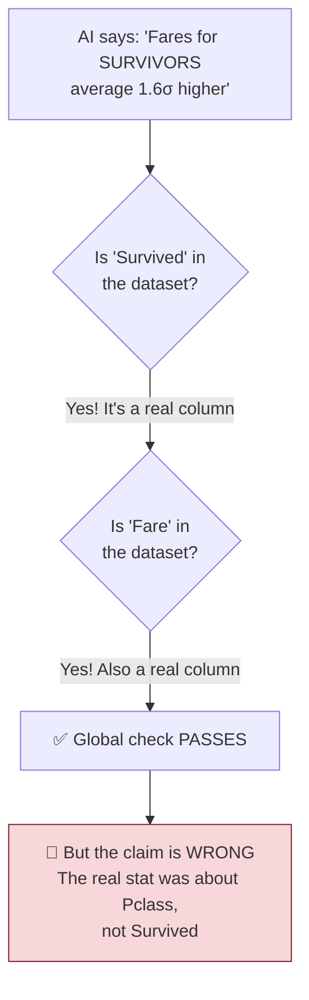
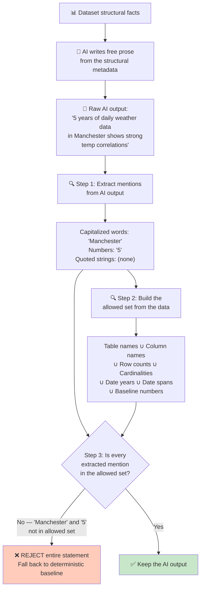
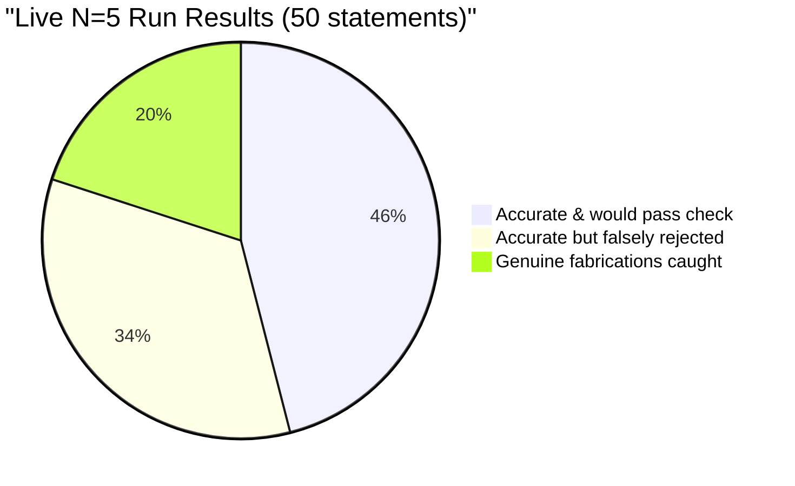

# 02 — Generate Then Verify — How It Works

## The Core Idea in One Sentence

Let the AI write whatever it wants, then **run a spell-checker for facts** — reject any sentence that mentions something not in the data.

---

## Why This Should Work (In Theory)

If the AI says "Manchester" but the data never mentions Manchester, a simple check can catch it. Build a list of every name, number, and value that legitimately comes from the dataset, and reject any AI output that introduces something not on the list.

## The Known Hole (Why This Doc Exists as a Warning)

**This approach cannot catch F1 — misattribution.** Here's why:

The problem: **every word in the false sentence is a real thing from the dataset.** The AI just connected them incorrectly. A global "is this word in the data?" check can't distinguish right connections from wrong ones.

---

## How Data Flows Through the System

### The "Allowed Set" — What Counts as Legitimate

The checker builds a set of everything the AI is allowed to mention:

1. **Table and column names** (case-insensitive)
2. **Numbers** from row counts, cardinalities (with separator normalization: "5,437" = "5437")
3. **Year numbers** extracted from date ranges
4. **Date span lengths** (e.g., if dates span 2015–2024, then "9" and "10" are allowed)
5. **Numbers already in the baseline headline** (carryover from the deterministic template)

That's **5 closure rules** — under the ≤6 ceiling.

### What's Deliberately NOT a Closure Rule

Spelled-out numbers ("ten years") are invisible to the checker. Only three types of things are extracted: capitalized words, digit sequences, and quoted strings. Lowercase English words pass through unchecked.

---

## What Happened When They Tested It

### F1/F2/F3 Results

| Case | What Was Tested | Caught? | Expected? |
|---|---|---|---|
| **F1** | "Fares for survivors average 1.6σ higher" | ❌ **Not caught** | ✅ Yes — this is the known hole |
| **F2** | "weather data in Manchester" | ✅ **Caught** ("Manchester", "5") | ✅ Yes |
| **F3** | "which sank in April 1912" | ✅ **Caught** ("April", "1912") | ✅ Yes |

### New Fabrications Discovered During Testing

- `product_reviews` claimed "3 years" when real span is ~1.9 years → **caught**
- `ecommerce` claimed "5,687 rows" when real count is 5,437 → **caught**
- `stock_prices` claimed "No Leakage" when the data shows possible leakage → **caught only by luck** (title-cased words happened to trigger the check; a lowercase version would pass)

The "No Leakage" case reveals a **second structural hole**: the checker catches invented *entities* but has no opinion on inverted *conclusions* about real entities.

### The Fatal Problem: False-Reject Rate

**42.5% of accurate statements were falsely rejected** — more than double the ≤20% ceiling.

Why so many false rejects?

| Cause | Count | Example |
|---|---|---|
| Title-case styling | 10/17 | "Weather Data Reveals..." — every capitalized word looks like a proper noun |
| ISO date fragments | 4/17 | "2023-01-01" gets torn into "01", "01" which aren't individually allowed |
| Second-sentence capitals | 4/17 | "... — Explore insights!" — "Explore" looks suspicious after a dash |
| Month names | 3/17 | "January 2019" — months aren't in the allowed set as words |

### Scoreboard

| Dimension | Result |
|---|---|
| R1 Grounding | 🔴 **FAILS** — F1 misattribution and polarity reversal are structural blind spots |
| R2 Determinism | 🔴 **FAILS** — weather fabricated in 5/5 runs, different city each time |
| R3 Reach | ⚠️ Partially met when accurate |
| R4 Cost | ✅ One model call, zero-cost verification function |
| R5 Authoring burden | ✅ **Best advantage** — no hand-authored assets needed |
| R6 Portability | ✅ Provider-agnostic by construction |
| R7 Coverage | 🔴 Only 46% of attempts were both accurate and would pass |

### The Verdict

**Loses to D65 (the plain template) and loses to its own predicted successor (Approach 03).** The check works well for what it targets (invented entities/numbers: 10/10 caught) but:
- Can't catch misattribution (F1) — structural, unfixable
- Can't catch polarity reversal ("No Leakage" vs "possible leakage")
- Rejects nearly half of correct output on formatting grounds

**This approach was always designed as the baseline arm** to prove that Approach 03 (per-clause citation binding) is needed. It proved exactly that.

### An Accidental Production Incident

Importing prompt constants from `eval/synthesis/run.ts` accidentally triggered that file's `main()` function as a side effect — causing ~15 live calls against the Cloudflare staging Worker and overwriting evaluation results. Fixed by moving prompts to a separate `eval/synthesis/prompts.ts` module. Lesson: never import from an executable entry point; import from a side-effect-free sibling module.
