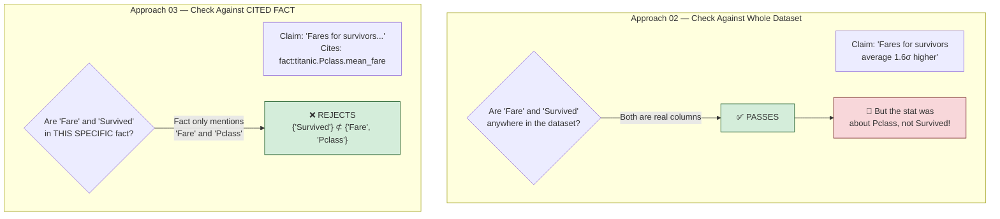
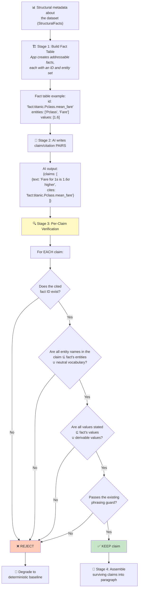
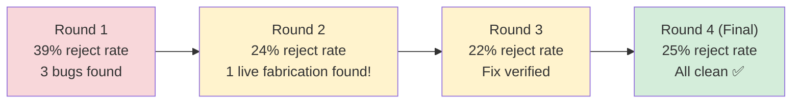

# 03 — Per-Clause Citation Binding — How It Works

## The Core Idea in One Sentence

Every sentence the AI writes must **cite a specific fact** it came from, and the system checks that **each sentence only mentions things from the fact it cited** — not just things from the dataset in general.

---

## Why This Is the Strongest Candidate

This is the **only approach that catches all three fabrication types**. The key insight: Approach 02 failed on F1 because it checked each sentence against the *entire dataset*. Change the unit of verification to **the specific cited fact**, and F1 dies:



**One mechanism catches all three failure classes:**

| Fabrication | Why It's Caught |
|---|---|
| F1 — "survivors" misattribution | `{survivors} ⊄ {Fare, Pclass}` — wrong column for cited fact |
| F2 — "Manchester" invented | `{Manchester} ⊄ {Date, City, temp columns}` — value not in any fact |
| F3 — "sank in April 1912" | No temporal fact exists to cite → claim can't be made at all |

---

## How Data Flows Through the System



### Stage 1: The App Builds an Addressable Fact Table

Every deterministic fact gets a **stable ID** and an **explicit entity set** — the list of column names and values that are allowed to appear in any sentence citing that fact:

```
CitableFact {
  id: "fact:titanic.Pclass.mean_fare_zscore"
  entities: ["Pclass", "Fare"]        ← ONLY these names may appear
  values: [1.6]                        ← ONLY these numbers may appear
  statement: "Pclass mean fare z-score is 1.6"
}
```

### Stage 2: AI Returns Bound Claims

The AI doesn't write free prose — it returns **(text, citation)** pairs:

```json
{
  "claims": [
    {
      "text": "Fare for \"1\"s is 1.6σ higher than other Pclass groups.",
      "cites": "fact:titanic.Pclass.mean_fare_zscore"
    }
  ]
}
```

### Stage 3: Each Claim Is Checked Against Its Own Cited Fact

For every claim, three checks run:
1. **Entity check**: every proper noun/column name in the text must be in the cited fact's entity set (or in a small "neutral vocabulary")
2. **Value check**: every number stated must be in the cited fact's value set
3. **Phrasing guard**: the existing word blocklist still applies

### Stage 4: Surviving Claims Assemble

Only claims that pass all checks make it into the final paragraph. If all claims fail, the system falls back to the deterministic baseline.

---

## The Neutral Vocabulary — The One Risk Area

Words like "rows", "records", "values", "column", "average", "higher" must be allowed or nothing passes. This is a **closed, reported list** — exactly 25 words. Every word added widens what can pass the check. If this list grows too long, the approach quietly degrades into Approach 02.

---

## What Happened When They Tested It

### Four Live Rounds (Improving Each Time)



### Six Bugs Found and Fixed (All in the Checker)

None of these were anticipated — they only surfaced when real AI prose hit the checker:

| Bug | What Happened | Fix |
|---|---|---|
| **1. ISO dates split apart** | "2016-01-04" was torn into "2016", "01", "04" — fragments didn't match | Match whole ISO date tokens first |
| **2. Month names flagged** | "August" in a correct date claim was treated as an invented name | Exempt month names only when the cited fact includes a date |
| **3. Quoted names as values** | `'stock_prices'` in quotes was checked as a numeric value | Recognize quoted schema names as entity mentions |
| **4. Self-rejection** | The fact's own stored text ("excluded from analysis... Profile") was rejected | Add "Profile" to the fact type's own entity set |
| **5. snake_case splitting** | `order_items` was split into `order` + `items`, then `order` matched `orders` | Keep underscores as part of tokens |
| **6. Spelled-out numbers invisible** | "Seven review entries" passed when the real value was 20 — **a live fabrication** | Map word-numbers (zero–million) to digits before checking |

Bug #6 was the most important: it was a **false accept** (a fabrication that got through), not just a false reject. It directly falsified the first round's "clean" hand-audit conclusion.

### Kill Criteria Results

| Criterion | Result |
|---|---|
| **(a)** F1, F2, F3 all rejected as fixtures | ✅ PASS |
| **(b)** Zero live fabrications (final round) | ✅ PASS |
| **(c)** False-reject rate ≤ 25% | ✅ PASS (24.75%) — but close to ceiling |
| **(d)** Neutral vocabulary ≤ 25 words | ✅ PASS (exactly 25) |
| **(e)** Model compliance with {text, cites} format | ✅ PASS (92% well-formed) |

### Scoreboard

| Dimension | Result |
|---|---|
| R1 Grounding | ✅ **PASS** — Zero fabrications in final audited run |
| R2 Determinism | 🔴 Low — same facts, different phrasing each run |
| R3 Reach | ⚠️ Capped by what the app already computes |
| R4 Cost | ✅ ~1× current (same single model call) |
| R5 Authoring burden | ✅ **Zero** — everything auto-derived from structural facts |
| R6 Portability | ⚠️ Mechanism is provider-agnostic; Cloudflare not tested |
| R7 Coverage | ✅ All 5 samples produced non-empty fact tables |

### The Verdict

**Thesis validated.** This is the only candidate that catches all three fabrication types, confirmed through live testing. All kill criteria pass. The approach is closed for this session.

### What It Doesn't Solve

- **R3 Reach is capped**: the model can only say things that have a citable fact, so "well-suited for CLV" needs a capability fact to cite — meaning this **pairs naturally with Approach 01's `detectCapabilities`**. They're complements, not rivals.
- **R2 is still low**: which claims appear varies run to run.
- **One remaining gap**: a prose date with an explicit day-of-month ("January 7, 2019" instead of "2019-01-07") still gets rejected. This was deliberately left unfixed because allowing small day numbers (1–31) as values would weaken the check on unrelated facts.
