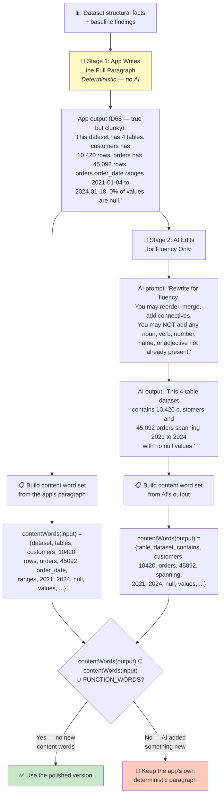
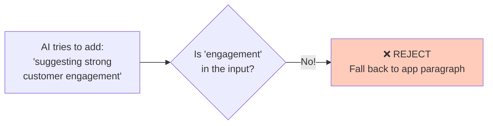

# 04 — Model as Editor — How It Works

## The Core Idea in One Sentence

Flip the roles: the **app writes the paragraph** (possibly clunky, definitely true), then the AI may only **polish it for readability** — forbidden from adding any new content word.

---

## Why This Should Work

F1, F2, and F3 are each a **new content word** appearing in output: "survivors" (not in the app's sentence about Pclass), "Manchester", "1912". If the AI's output must satisfy this rule:

> **Every content word in the output must already exist in the input**

...then none of those fabrications can appear. This is the same "make it unrepresentable" logic the current system already uses for numbers — generalized from a headline to a whole paragraph.

---

## How Data Flows Through the System



### Stage 1: The App Writes (This Is D65)

The app builds a complete, correct paragraph from structural facts. It reads like a debug log, but every word is true.

### Stage 2: The AI Polishes

The AI gets one instruction: rewrite for fluency. It can:
- ✅ Reorder sentences
- ✅ Merge sentences
- ✅ Add articles, prepositions, conjunctions ("and", "with", "of", "the")
- ❌ Cannot add any noun, verb, number, name, or adjective

### Stage 3: Word-Set Inclusion Check

The verification is a simple set comparison:

```
contentWords(AI output) ⊆ contentWords(app input) ∪ FUNCTION_WORDS
```

Where `FUNCTION_WORDS` is a **small, closed, hand-authored list** (~40 words max):
- Articles: "the", "a", "an"
- Prepositions: "with", "of", "across", "from"
- Connectives: "and", "containing", "spanning"
- Copulas: "is", "are"

### Why This Is Stronger Than Approach 02

The allowed set is **the app's own sentence**, not the whole dataset. "Survived" being a real column is irrelevant if the app's sentence about Pclass never mentioned it. F1 dies for free.

---

## What the Expected Failure Looks Like



Models asked to "improve fluency" tend to add interpretive flourishes. Each one is a content word and must be rejected. The **accept rate** (how often the AI stays within budget) is the critical measurement.

---

## Kill Criteria

| Criterion | What It Tests |
|---|---|
| **(a)** F1, F2, F3 rejected as fixtures | Structurally expected — if it fails, the word set leaks |
| **(b)** FUNCTION_WORDS ≤ 40, contains no domain nouns | The only place this approach can be silently compromised |
| **(c)** The polish is worth it (blind comparison) | If readers can't prefer the AI version, ship D65 alone |
| **(d)** Accept rate ≥ 60% | Below that, users mostly see the unpolished version anyway |
| **(e)** N=5 determinism check | Does it matter whether a run was rejected or accepted? |

### The Most Important Criterion

**(c)** is the one most likely to fail, and **failing it is a good outcome** — it means the AI wasn't the missing piece, the deterministic writing was. That cheaply retires the question.

---

## What It Doesn't Solve

- **Reach is exactly D65's reach.** The AI adds *fluency*, never *insight*. "Well-suited for CLV" only appears if the app's paragraph already said it.
- **Ceiling is set by `deterministicNarrative.ts`.** Pair with Approach 01's `detectCapabilities` to raise the ceiling: 01 supplies the content, 04 makes it read well.

## Status

**Untested.** The cheapest candidate to verify — the check is a set-inclusion test, so the session either works or fails inside an hour.
