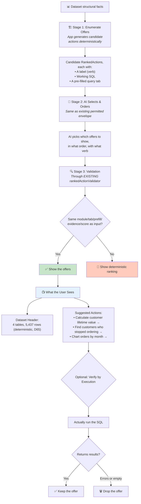
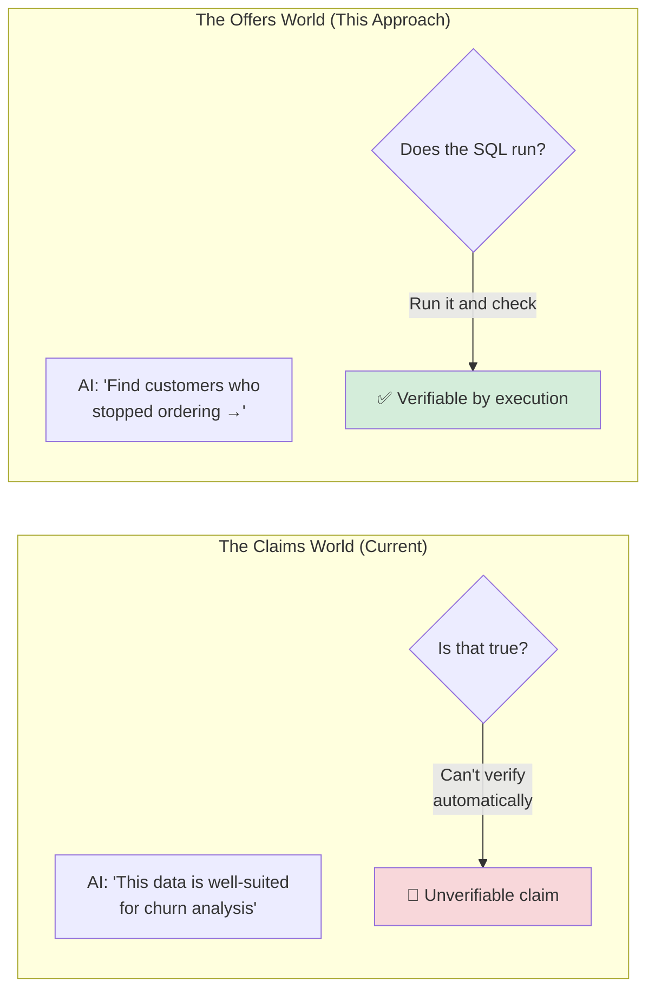

# 05 — Offers, Not Claims — How It Works

## The Core Idea in One Sentence

Stop asking the AI to make **statements about the data** and start asking it to suggest **things the user might want to do** — because a bad suggestion is just ignored, while a bad statement is misinformation.

---

## The Big Reframe

Look at the target sentence the system is trying to produce:

| As a claim (current goal) | As an offer (this approach) |
|---|---|
| "This dataset is well-suited for calculating Customer Lifetime Value." | "Calculate customer lifetime value →" |
| "…analyzing churn, and forecasting seasonal demand." | "Find customers who stopped ordering →" / "Chart orders by month →" |
| "This appears to be an e-commerce dataset." | *(drop it, or make it a question: "Working with orders and customers?")* |

The left column requires the app to be **right about suitability** — an interpretive claim about unknown user data. The right column requires the app to produce a **runnable query and a label**. If the label is a bad fit, the user ignores it.

**The epistemic burden drops from "true" to "useful", and the failure mode drops from misinformation to noise.**

---

## How Data Flows Through the System

### Why This Is Cheap to Build

An "offer" is already a first-class object in the codebase:

- **`RankedAction`** — the existing infrastructure already carries `{module, tab, prefill, evidence, score, verb}`
- **`rankedActionValidator`** — already lets the AI re-order and re-verb while holding everything else byte-identical
- **Suggested Explorations** — already shows top-3 suggestions that open pre-run query tabs

So the AI's job becomes **exactly what the existing validator already safely permits**: choosing which offers to surface, in what order, with what verb. **No new validator is strictly required.**

### The Honesty Property

An offer's truth claim is only: *"this query runs and returns something."* The app can verify this by **actually running the query**. That's checkable in a way "well-suited for CLV" never is.

---

## Why This Dissolves the Fabrication Problem

All three fabrications dissolve — not because they're caught, but because **the form changes**:
- F1 (misattribution): no statement is made about what columns correlate
- F2 (invented value): no city name needs to be stated
- F3 (world knowledge): no historical claim needs to be made

---

## Kill Criteria

| Criterion | What It Tests |
|---|---|
| **(a)** Zero fabrications | Trivially expected — no free-text claims are emitted |
| **(b)** Every offer produces runnable SQL | Actually execute it — don't just eyeball it |
| **(c)** Does counts + offers satisfy the §4 ambition? | **The judgment call.** Put the mock-up next to the target paragraph and decide honestly. |
| **(d)** Offer relevance | Does ecommerce get CLV/churn offers? Does titanic get survival/class/fare offers? |
| **(e)** N=5 determinism on ordering | Does the offer *set* stay stable even if order moves? |

### The Critical Criterion

**(c)** is the one that decides everything: does showing "counts + clickable suggestions" actually satisfy the product goal, or does it feel like the app dodged the question? This is a judgment call that **cannot be automated** — you have to see it.

---

## A Gap They Found

The `verb` field in `RankedAction` is free text, and `rankedActionValidator` does **not** run the phrasing guard on it. The AI could smuggle a claim into the verb. This needs to be closed by applying the phrasing guard to verbs too.

---

## What It Doesn't Solve

- **It does not deliver §4's paragraph.** It argues the paragraph was the wrong ask. If the prose paragraph is genuinely wanted, pair this with Approach 01 or 04 for the header line.
- **The domain guess ("This appears to be e-commerce") is dropped entirely**, or demoted to a question.

## Status

**Untested.** The **strongest product-shape move** in the folder — it may dissolve the problem entirely. Also the **cheapest** to build (most of it is already built) and the **cleanest to port** to Cloudflare.
