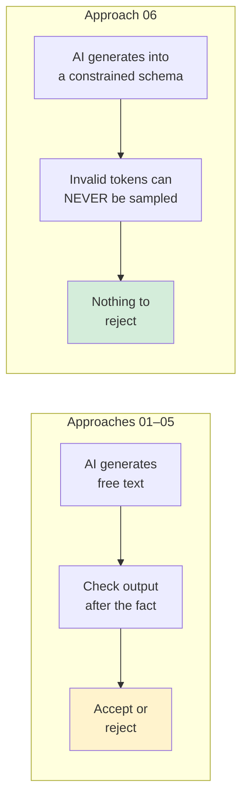
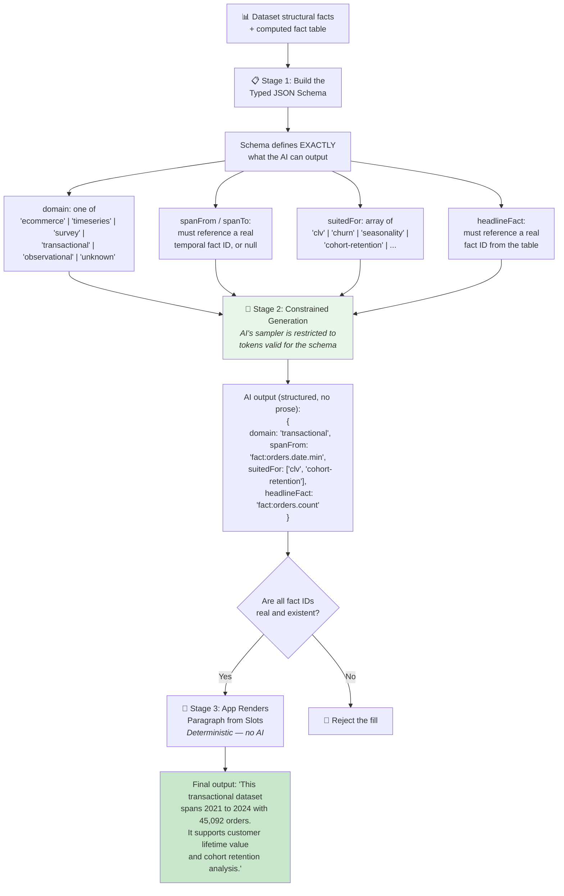
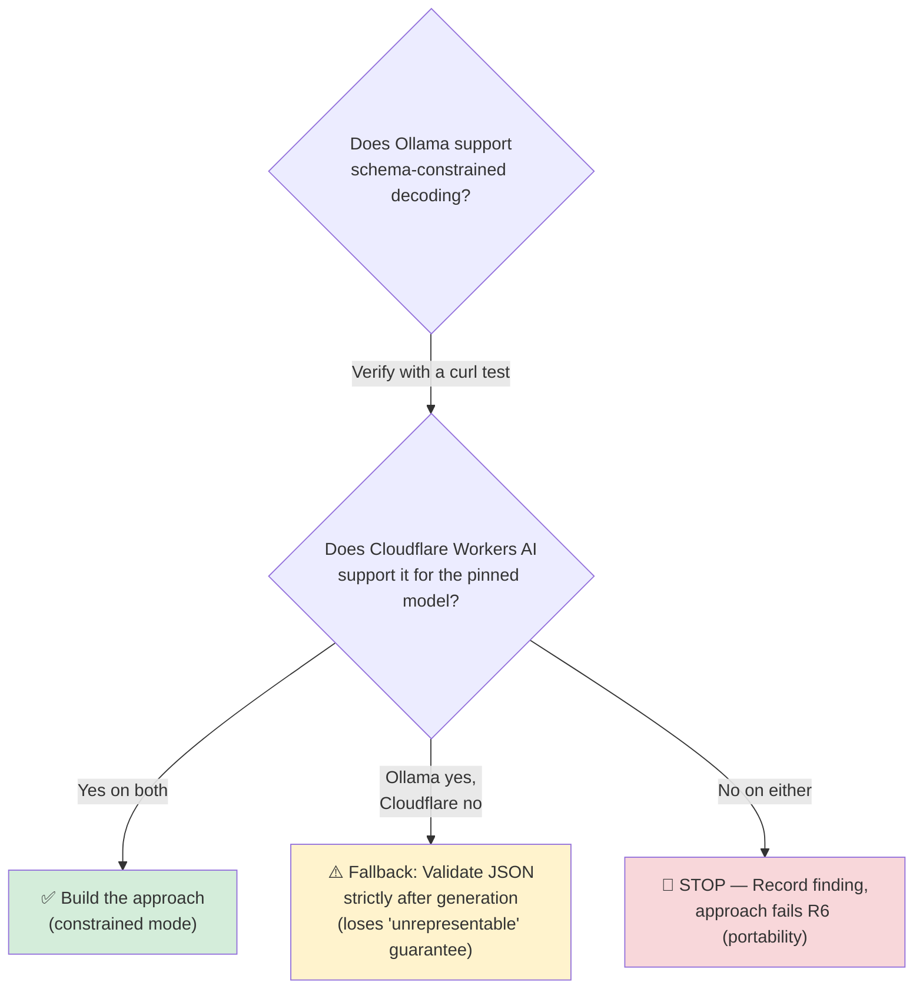

# 06 — Constrained Decoding into Typed Slots — How It Works

## The Core Idea in One Sentence

Instead of letting the AI write text and then checking it, make it **impossible for the AI to generate invalid output** in the first place — by constraining the AI's "keyboard" to only produce valid selections from a pre-defined schema.

---

## Why This Is Architecturally Different

Every other approach in this folder follows the pattern: **generate → check → maybe reject.** This one moves enforcement to **the moment of generation**:

"Manchester" isn't rejected — it **can never be generated**, because the `domain` field is an enum of five strings and none of them is a city name.

---

## How Data Flows Through the System

### Stage 1: Build the Schema

Every content-bearing field is a **closed enum** or a **reference to a real fact ID**. No free-text fields exist. The key design decision: `unknown` must be a first-class option — a schema with no escape hatch forces a guess, which is how fabrication gets reinvented under a different name.

### Stage 2: Constrained Generation

The AI model's sampler is restricted so that at each token position, only tokens that keep the output valid against the JSON schema can be selected. "Manchester" is simply not a valid token in the `domain` field's position.

### Stage 3: Deterministic Rendering

The app renders the final paragraph from the filled slots. The AI contributes **structured judgment** (which domain, which analyses, which fact leads) and **zero prose**.

---

## The Critical Prerequisite: Platform Support Check

**This approach is gated on a capability that may not exist.** Before building anything:

- **Ollama**: supports structured outputs via a JSON-schema `format` parameter — but needs verification that it actually works on the installed version
- **Cloudflare Workers AI**: varies by model. If it doesn't support constrained decoding, the approach degrades into a strict-schema variant of Approach 01 (still safe, just no longer "impossible to generate wrong output")

---

## Kill Criteria

| Criterion | What It Tests |
|---|---|
| **(a)** Works on BOTH Ollama and Workers AI | If Cloudflare unsupported with no fallback → approach fails |
| **(b)** Zero fabrications | Expected by construction — if one appears, a free-text field leaked in |
| **(c)** `domain` is right or honestly `unknown` | Titanic classified as "ecommerce" is a hard fail; "observational" or "unknown" is fine |
| **(d)** `suitedFor` values match the data | "seasonality" on a dataset with no date column = fail |
| **(e)** N=5 stability | Structured output should be much more stable than prose — if it isn't, that's an important negative result |

---

## What It Doesn't Solve

- **Coverage**: a closed enum can only describe dataset shapes someone anticipated (same limitation as Approach 01)
- **F1 specifically**: `headlineFact` picks which fact leads, but the renderer template phrases it — misattribution becomes a **renderer bug** (code you own) rather than a model failure (a genuine improvement)
- **Reads as templated** as Approach 01 — combine with Approach 04 for fluency

## Status

**Untested, gated on a platform check.** If constrained decoding is supported, this provides the tightest guarantee in the folder. If not, it collapses into a strict-validation variant of Approach 01.
