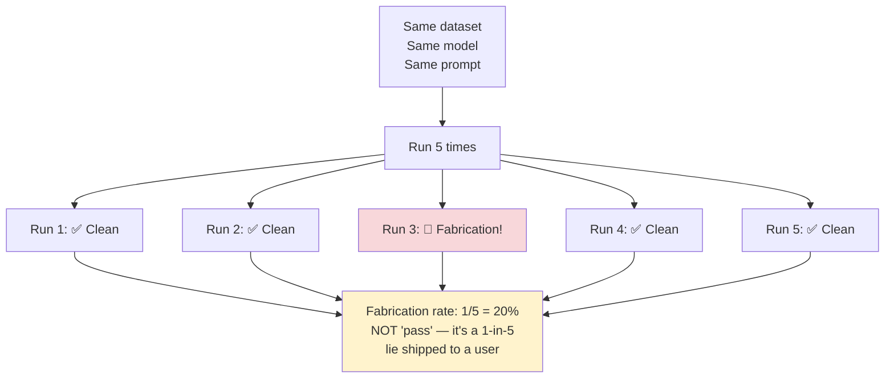
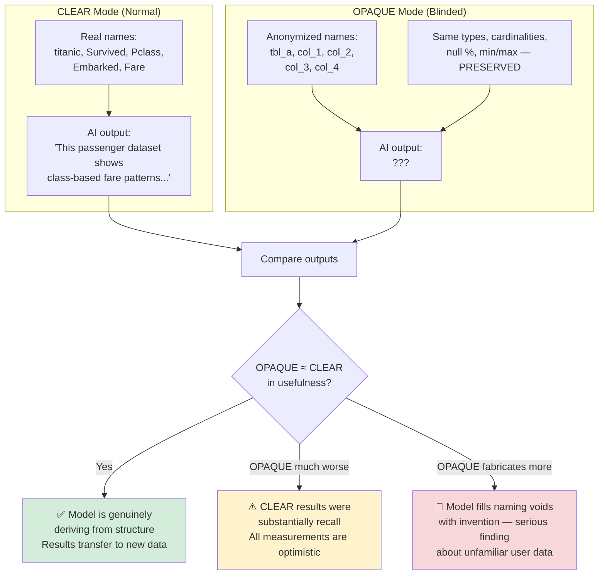

# 07 — Diagnostics (Measurement Instruments) — How They Work

## What This Is

**These are NOT candidate solutions.** They are two measurement tools that answer questions every other experiment has to assume. Neither ships. Both are cheap to run.

---

## D1 — N-Sampling Variance: "Was That Result Luck?"

### The Question

How much of a candidate's safety is real, and how much is one lucky roll?

### Why It Matters

The probe doc recorded the **identical** 891-row Titanic input producing:
- Run 1: *"the Titanic, which sank in April 1912"* (fabrication!)
- Run 2: *"not explicitly stated in the data"* (correct!)

Same session, same input. A fabrication rate of 1-in-5 looks like a clean pass if you only sample once.

### How It Works

For each candidate × each dataset, run **N=5 identical requests** and record:

| What's Measured | What It Tells You |
|---|---|
| **Claim-set stability** | Do the same claims appear every time? |
| **Fabrication rate** | How many of the N runs contain a fabrication? (A rate, not pass/fail) |
| **Reject rate variance** | Does the same input sometimes pass and sometimes fail the validator? |

### The Rule

**Report fabrication as a rate, never as pass/fail.** A candidate at 1/25 is not "safe" — it's a 1-in-25 falsehood shipped to a user. For a data-integrity product, that's a different kind of bad than a crash.

### Possible Spin-Off

**Self-consistency filtering**: run N=3, keep only claims appearing in a majority. It would have caught F3. But at 3× cost per synthesis, it's hard to justify unless nothing cheaper works.

---

## D2 — Opaque-Schema Ablation: "Is the AI Deriving or Remembering?"

### The Question

When the AI produces something impressive about the Titanic dataset, is it **deriving insights from the data structure** or **remembering the Titanic from its training data?**

### Why It Matters

The five test datasets — titanic, weather, stock_prices, product_reviews, ecommerce — are exactly the kind of canonical fixtures an AI has seen thousands of times. F3 ("sank in April 1912") **proves** training-data recall is in play. So every "good" result on these datasets might be substantially unearned.

### How It Works

Run each candidate twice per dataset:

### The Fabrication Tripwire (The Clever Part)

In OPAQUE mode, **any domain-specific noun in the output is necessarily invented**, because the payload contains no such word. "Passengers", "weather", "1912" — if any of these appear when the columns are named `col_1`, `col_2`, etc., it's a confirmed fabrication with no hand audit needed.

This makes OPAQUE mode **the cheapest reliable fabrication detector available** — and it could be a permanent test arm, not a one-off.

### What OPAQUE Is NOT

It's a diagnostic, not a shipping proposal. You wouldn't obfuscate real user schemas — that would destroy the domain understanding that makes synthesis worth having. Don't confuse the instrument with a candidate.

---

## What to Build

1. **`opaqueFacts()`** — deterministic renaming function. Replaces table/column names with `tbl_a`/`col_1` etc. while preserving every structural field bit-for-bit.
2. **Domain-noun tripwire list** — place names, entity nouns, four-digit years. Any hit in OPAQUE output = confirmed fabrication.
3. **`--repeat=N` flag** on the harness, keeping all N runs (not collapsed to pass/fail).

## Correctness Checks (Not Kill Criteria — These Are Instruments)

- `opaqueFacts` preserves every structural field exactly
- The tripwire produces **zero hits on OPAQUE deterministic-baseline output** (if it does, the tripwire is wrong)
- N=5 must be genuinely independent calls (no cached responses)

## Status

**Untested.** Run D1 alongside whichever candidate you're testing — R2 (determinism) is not optional. Run D2 early — if it shows the AI is mostly remembering rather than deriving, it re-scopes every other result in this folder.
