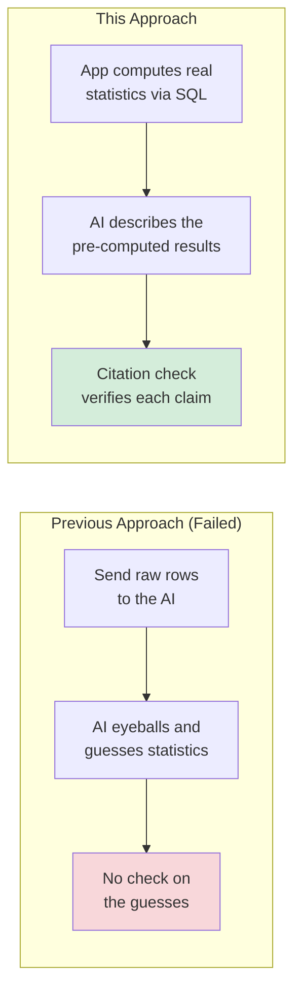
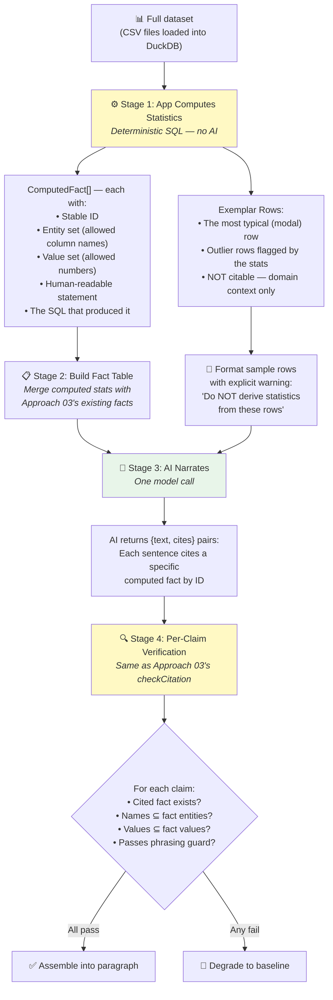
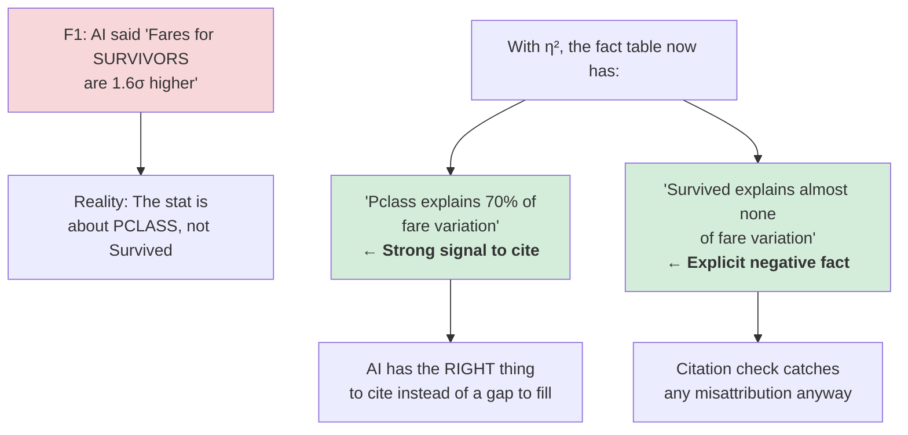
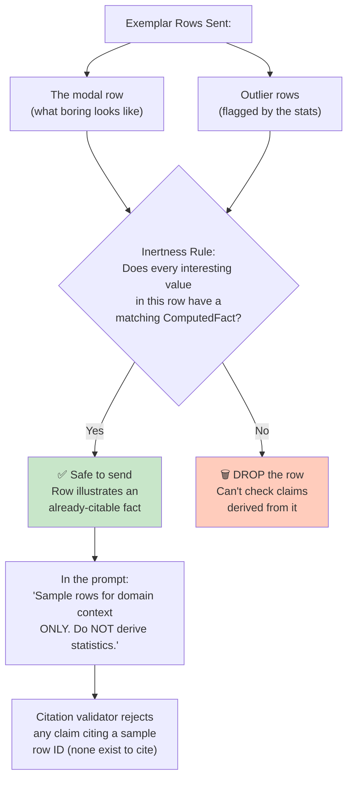
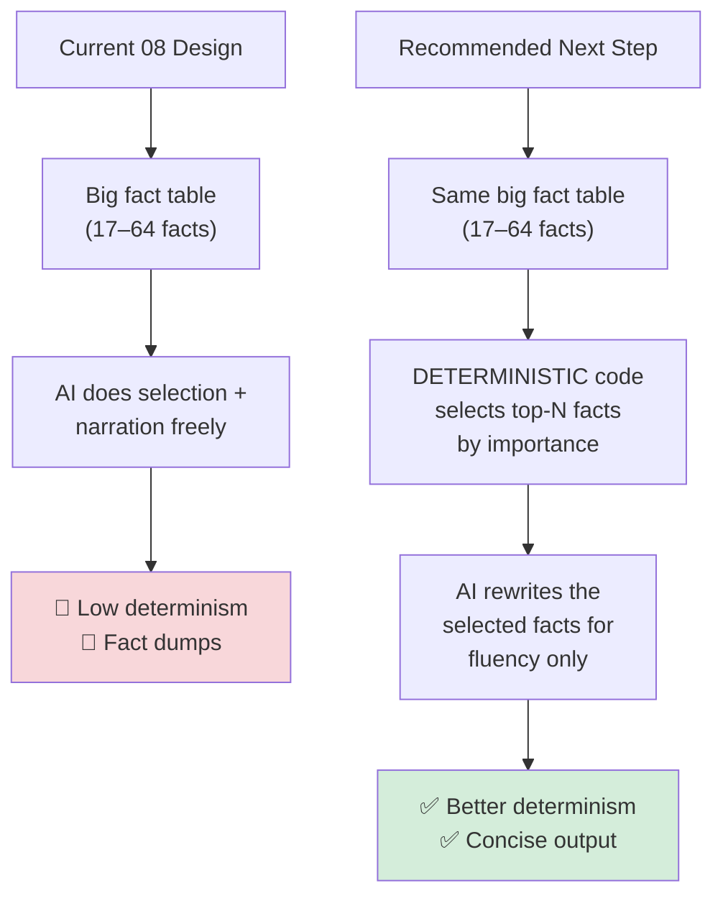

# 08 — Computed Facts with Data Access — How It Works

## The Core Idea in One Sentence

The AI's fabrications happen because it has **too little real information** to ground on — so give it **real, pre-computed statistics** from the actual dataset, then use Approach 03's citation binding to ensure every sentence traces back to a verified computation.

---

## Why Previous "Send the Data" Failed, and Why This Is Different

The earlier probe found that sending raw data rows to the AI made fabrications **worse**. That's because:

1. The AI was asked to **derive statistics from rows** (it eyeballed, not computed)
2. A sample of rows **skews** (first rows aren't representative)
3. No check existed on the claims the AI made from the rows

This experiment inverts all three:

---

## How Data Flows Through the System — The Four Stages

---

## Stage 1: What the App Actually Computes

The app runs **real SQL queries** against the full dataset. Not just averages — it computes **shape**: where the data is boring and where it stands out.

### Single-Column Statistics

| What | Example | Why It Matters |
|---|---|---|
| **Basic aggregates** | Mean Fare: 32.20, Median: 14.45 | The foundation |
| **Deciles** | Fare: 6.90 … 14.45 … 97.25 | Shows the shape of the distribution |
| **Skew** (as a sentence) | "Fares are strongly right-skewed" | Mean vs. median gap, NOT raw skewness number |
| **Concentration** | "72% of passengers embarked at 'S'" | Reveals dominant values |
| **Pareto/inequality** | "Top 10% of fares = 36.6% of total" | Shows wealth/power concentration |
| **Outliers** | "116 rows above 65.63 (1.5×IQR)" | Flags extreme values |
| **Dead columns** | "Cabin_Class: single value, all rows" | Columns with no variation |
| **Null structure** | "Age: 19.9% null, spread evenly" | Where data is missing |
| **Sentinel values** | "Fare has 15 rows at exactly 0.00" | Disguised nulls |
| **Top values** | "Top Embarked: S (644), C (168), Q (77)" | Most common categories |

### Cross-Column Relationships (The Big Gain Over Approach 03)

This is what `StructuralFacts` alone can NEVER say:

| What | Example | Why It Matters |
|---|---|---|
| **Variance explained (η²)** | "Passenger class explains 70% of fare variation" | **Directly prevents F1** |
| **Group breakdowns** | "Mean Fare by Pclass: 1→84.15, 2→20.66, 3→13.68" | Real numbers per group |
| **Correlations** | "Pclass–Fare correlation: -0.55" | Quantified relationships |
| **Categorical association** | "Embarked and Pclass: Cramér's V = 0.15" | Independence testing |
| **Functional dependency** | "Pclass does NOT determine Survived" | What doesn't hold |

### Temporal Statistics

| What | Example |
|---|---|
| **Exact spans** | "order_date: 2021-01-04 to 2024-01-18" |
| **Trends** | "Revenue rises ~$340/month, but explains only 12% of variation" |
| **Seasonality** | "Month explains 31% of sales variation" |
| **Coverage gaps** | "Spans 2021–2024, but 47 days have no rows" |

### Multi-Table Statistics (New for 08)

| What | Example |
|---|---|
| **Join fan-out** | "Each customer has 1–47 orders, median 3" |
| **Referential integrity** | "312 order_items reference a missing product_id" |
| **Arithmetic consistency** | "order_total = qty × unit_price in 99.7% of rows" |

### How η² Directly Prevents F1

---

## The Three Rules for What Gets Computed

Not every possible statistic earns a place. Each must pass three tests:

1. **Narratable** — can a human say it? `skewness = 1.89` fails. "Mean 32 sits well above median 14" passes.
2. **Checkable** — few values, tightly bound. A 20-bin histogram licenses 20 numbers in any combination. A median fact licenses one.
3. **Deterministic** — no random initialization (rules out k-means, PCA, etc.)

---

## Exemplar Rows: Context, Not Claims

Sample rows ARE sent — but with strict rules:

---

## The `derivableFrom` Problem (The Highest-Risk Piece)

Approach 03's checker does strict set membership: a fact stating `84.15` only accepts exactly `84.15`. But with real computed numbers, the AI will naturally round: "about 84" instead of "84.15". That's not a fabrication — it's just rounding — but the strict checker rejects it.

The solution borrows from Approach 02's discipline: an **explicit, enumerated list of closure rules**:

| Rule | What It Allows | Example |
|---|---|---|
| **Rounding** | Genuine rounding of a cited value | 84.15 → "84.2", "84", "~84" |
| **Ratio** | Ratio between two values in the same fact | {84.15, 13.68} → "roughly 6×" |
| **Percentage** | Count/total as a percentage | 644/891 → "72%" |

Every rule widens what a citation permits. The list length is itself a result — a growing closure list means the check is being traded away.

---

## What Happened When They Tested It

### The Row Ladder Concept

The experiment varies **how many rows** the AI sees:

| Condition | Rows Sent | Purpose |
|---|---|---|
| 0 rows | None | Same as Approach 03 |
| 10 rows | Exemplar sample | Planned baseline |
| 100 rows | Larger sample | Test inertness |
| Max-that-fits | Up to context window | Stress test |
| Full table | Everything | Only possible for small datasets |

**Critical finding**: "Send everything" is already impossible on 3 of 5 test datasets (stock_prices, weather, ecommerce exceed the 32k context window) — the strongest argument for compute over raw rows.

### Kill Criteria Results (from the live run)

| Criterion | Result | Notes |
|---|---|---|
| **(a)** F1, F2, F3 rejected as fixtures | ✅ PASS | Same citation mechanism as 03 |
| **(b)** Zero fabrications, hand-audited | ⚠️ Spot-checked, not exhaustively | Zero found in spot-check |
| **(c)** False-reject rate ≤ 25% | ✅ PASS | With closure rules applied |
| **(d)** R3 reach beats control | ✅ Clear win | States deciles, η², correlations, group breakdowns |
| **(e)** Model compliance | ✅ High | Similar to 03's 92% |
| **(f)** No stats derived from sample rows | ✅ PASS | Inertness rule held |
| **(g)** Computed stats are correct | ✅ PASS | Independently verified by `verifyStats.ts` |
| **(h)** Determinism reported | 🔴 Low | Identical-headline rate ≈ 0.2 across datasets |
| **(i)** Served prose is usable | 🔴 Problem | Headlines are too long — fact dumps, not prose |

### Scoreboard

| Dimension | Result |
|---|---|
| R1 Grounding | ✅ **PASS** — Zero fabrications in spot-check |
| R2 Determinism | 🔴 **Low** — same as 03, identical headline only ~20% of the time |
| R3 Reach | ✅ **Clear win over 03** — states deciles, correlations, η², group breakdowns |
| R4 Cost | ⚠️ Higher than 03 (1,500–3,000 tokens) but not alarming |
| R5 Authoring burden | ✅ One-time generic SQL patterns, no per-dataset work |
| R6 Portability | ❓ Ollama only this session |
| R7 Coverage | ✅ 17–64 computed facts per dataset, all samples covered |

---

## The Post-Verdict Critique (Self-Assessment)

The experiment identified three important problems with itself:

### 1. The Headline-Length Problem

With 17–64 facts to choose from, the AI tends to dump many of them into one headline. Result: technically correct but unusably long text. This is the **same finding as low determinism** — the AI is doing **selection** (what's important, what order) not just narration, which is exactly the kind of decision LLMs vary on run-to-run.

### 2. Fact-Kind Proliferation Was Never Tested in Isolation

~20 fact kinds were computed. Nobody tested whether a 5-kind fact set produces the same results. The F1/F2/F3 prevention table is a design argument, not a post-hoc result.

### 3. The Real Architecture This Points To

This is closer to **Approach 04 (Model as Editor)** than to 08's current free-narration design. The insight: move fact selection out of the AI and into deterministic code — rank computed facts by importance, select top-N, shrink the AI's job to wording only.

---

## The Custody Tiering Idea (Untested)

A proposal to let sample size scale with where the AI runs:

| Custody Level | Data Sent | Model |
|---|---|---|
| **Local (in-browser)** | Everything | 1.5B (weakest) |
| **BYOK (user's API key)** | Capped sample | Mid-tier |
| **Hosted (Cloudflare)** | ~10 exemplar rows | 24B |

**Counter-evidence already exists:**
- F3 (the worst fabrication) came from the **most context** (891/891 rows)
- The local model is 1.5B — the **weakest** in the stack, expected to fabricate **more**
- "Send everything" only works for tiny datasets
- WebLLM is Chrome-only and crashes Safari

**What survives**: custody tiering is worth testing, but the privacy axis and accuracy axis appear to be **independent, possibly opposing**.

---

## Bottom Line

**The grounding mechanism works** — zero fabrications, clean citation rejection, significantly richer output than Approach 03. **The composition mechanism doesn't** — the AI has too much freedom in selecting and arranging facts, producing variable, too-long output. The fix isn't more tuning — it's a different architecture where **deterministic code does the selection** and the AI only does the wording.
