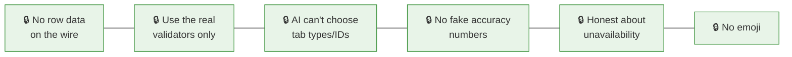
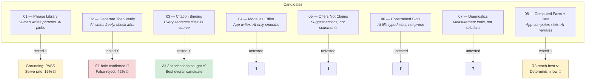

# AI Architecture Experimentation — Plain-Language Overview

## What Is This Folder?

This folder contains **8 experimental approaches** to fixing a specific problem: DataScope's AI sometimes **makes stuff up** when describing a user's dataset. None of these experiments are shipped or decided — they're candidates being compared against each other.

---

## The Problem in Plain English

DataScope wants to show users a smart, helpful description of their uploaded data. The **dream output** looks like:

> "This appears to be an E-Commerce dataset with two tables containing 10,420 customers and 45,092 orders. The data spans from January 2021 to January 2024. This dataset is well-suited for calculating Customer Lifetime Value (CLV), analyzing churn, and forecasting seasonal demand."

What the system **actually produces today** is:

> "4 tables, 5,437 rows, 0% null values — see what's inside."

Both are true. But only the dream version answers "what is this data good for?"

### Why Can't the Current System Do Better?

The current system (called ADR-010) lets the AI do exactly two things:
1. Rephrase one headline
2. Reorder/re-verb some suggested actions

The validators that check the AI's work only verify **structure** (are all the right fields present?) — not **meaning** (does the text actually match the evidence?). The AI's prose is essentially unchecked free text with just a word blocklist.

### The Three Known Fabrications

Every experiment must be tested against these three real-world cases where the AI lied:

```mermaid
flowchart TD
    subgraph F1["F1 — Misattribution"]
        F1A["AI said: 'Fares for survivors<br/>average 1.6σ higher'"]
        F1B["Reality: The stat was about<br/>Passenger Class, not Survived"]
        F1C["Problem: Real columns, wrong<br/>relationship claimed"]
        F1A --> F1B --> F1C
    end

    subgraph F2["F2 — Invented Value"]
        F2A["AI said: '5 years of daily weather<br/>data in Manchester'"]
        F2B["Reality: City is Springfield,<br/>span is ~10 years, not 5"]
        F2C["Problem: Made up a city name<br/>and a date range"]
        F2A --> F2B --> F2C
    end

    subgraph F3["F3 — World Knowledge Injection"]
        F3A["AI said: 'the Titanic, which<br/>sank in April 1912'"]
        F3B["Reality: There is NO date<br/>column in the data at all"]
        F3C["Problem: AI recalled real-world<br/>knowledge not in the data"]
        F3A --> F3B --> F3C
    end

    style F1 fill:#fee,stroke:#c33
    style F2 fill:#fef,stroke:#c3c
    style F3 fill:#ffe,stroke:#cc3
```

Plus a fourth property: **F4 — Non-determinism.** The same exact input can produce a fabrication one time and a correct answer the next. A single passing test proves nothing.

### Why "Just Write a Better Prompt" Doesn't Work

These fabrications happened across **three different AI models** and **three different serving methods**. This is a problem with the system's architecture, not with any specific prompt wording. That's why all experiments focus on changing the validation/composition machinery, not prompt engineering.

---

## The Control: What Every Experiment Must Beat

**D65 — Deterministic narration.** This is a templated paragraph with no AI involved at all. It can never fabricate, costs nothing, and is considered an acceptable fallback. Any experiment that isn't clearly better than D65 loses to it.

## Rules No Experiment Can Break

1. **No cell values or sample rows cross the wire** — only structural metadata (table names, column names, types, null %, cardinality, date ranges)
2. **Score through the product's own validators** — no experiment-only validation
3. **AI can't choose what tabs/modules exist** — it just describes data
4. **No unearned accuracy numbers** shown to users
5. **Be honest when AI is unavailable** — don't pretend baseline is AI output
6. **No emoji** — use HUD glyphs only (◈ ✦ ◆ ⚙ ✓ ⚠)

## How Every Experiment Is Graded

All 8 experiments are scored on the same 7-point rubric:

| # | What's Measured | What It Takes to Pass |
|---|---|---|
| R1 | **Grounding** — does it make things up? | Zero fabrications. One lie = fail. |
| R2 | **Determinism** — same input, same output? | Claims must be stable across runs |
| R3 | **Reach** — how useful is the output? | Must beat plain template (D65) |
| R4 | **Cost** — how expensive? | ≤ ~2× current cost |
| R5 | **Authoring burden** — how much human work? | Stated honestly |
| R6 | **Portability** — works on different AI providers? | Must work on Ollama AND Workers AI |
| R7 | **Coverage** — works on how many dataset types? | Stated honestly |

---

## How Testing Works

- **Ollama** (a local AI server) is used for all iteration — it's free
- **5 test datasets**: titanic, weather, stock_prices, product_reviews, ecommerce
- Each experiment runs **N=5 repeats** per dataset (to catch non-determinism)
- Every claim is **hand-checked** against the raw CSV files

## The 8 Experiments at a Glance

**If you only test three**: Start with 05 (might dissolve the problem entirely), then 03 (catches all fabrication types), then 04 (simple pass/fail within an hour).

## Already Rejected Ideas

| Idea | Why Not |
|---|---|
| Better prompt | Tried twice. Fabrications are architectural, not wording-level. |
| Send raw data rows | Made things worse. Models eyeball, not compute. |
| Bigger model / more context | The worst fabrication (F3) came from the MOST context. |
| Model self-confidence scores | Uncalibrated and misleading. |
| Fine-tuning | Can't guarantee zero fabrication. |

---

## A Bug They Found Along the Way

When the AI provider fails (e.g., quota exhaustion), the server returns HTTP 200 with the deterministic baseline echoed back. The client thinks the AI ran successfully and just agreed with the baseline. This makes "AI unavailable" **indistinguishable from "AI had nothing to add"** — including to the evaluation harness. Every experiment needs an honest "unavailable" signal.
