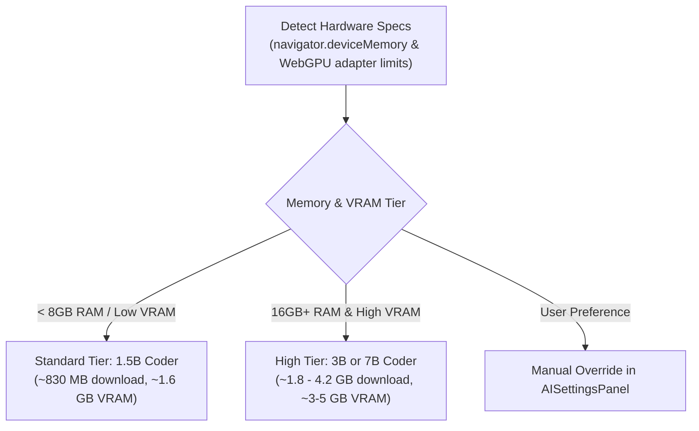

# Backlog: Dynamic WebLLM Model Scaling by Hardware Spec

**Tier:** backlog · **Master spec:** §5.1, §11.2, §19, D2, D43, D70 · **ADR:** ADR-007

Dynamically select larger, higher-capacity local WebLLM models (e.g. 3B or 7B coders) when a user's device hardware meets specific RAM and VRAM capability thresholds, rather than strictly pinning a single 1.5B model for all devices.

## 1. Idea

Currently, the in-browser WebLLM provider ([`services/webllm.ts`](../../app/src/services/webllm.ts)) is pinned to `Qwen2.5-Coder-1.5B-Instruct-q4f16_1-MLC` (~830 MB download, ~1.6 GB VRAM footprint) per ADR-007. While 1.5B is verified to coexist in memory with DuckDB-Wasm on 8 GB RAM machines, it has documented weaknesses in complex SQL aggregation (e.g. aggregate-then-rank queries).

On higher-spec devices (16 GB+ RAM, discrete GPUs or high-end Apple Silicon with 8 GB+ WebGPU buffer headroom), the browser can easily host a 3B or 7B local model (e.g., `Qwen2.5-Coder-3B`, `Qwen2.5-Coder-7B`, or `DeepSeek-R1-Distill-Qwen-7B`). Dynamic model scaling probes the client's WebGPU limits and system memory to offer higher-tier local models.

## 2. Why Deferred

- **D43 Hard Gate & Spike Constraints:** ADR-007 explicitly pinned the 1.5B q4f16 coder because 3B variants (~2.5 GB+ VRAM) were unverified on standard 8 GB RAM machines during the initial D43 spike.
- **Cold Download UX:** A 3B/7B model requires a ~1.8 GB to ~4.2 GB network download, which significantly impacts initial warming time over WebLLMDock.
- **v0 / v0.25 Scope Boundary:** v0.25 focuses on establishing the baseline WebLLM client handoff with the single verified 1.5B model. Multi-tier model management adds UI complexity (tier selector) and matrix testing overhead.

## 3. Revive Trigger

- **User Demand & Hardware Capability:** Clear telemetry or user feedback requesting higher SQL generation accuracy locally from users on high-spec machines.
- **D43-style Memory Spike for 3B/7B:** Conducting a formal spike verifying that 3B/7B models coexist with DuckDB-Wasm on large datasets (~1M+ rows) without OOMing or thrashing GPU buffers on 16 GB+ RAM / 8 GB+ VRAM configurations.

## 4. Key Architectural & UX Details

1. **Hardware Detection**:
   - `navigator.deviceMemory` (RAM tiering).
   - `navigator.gpu.requestAdapter()` checking `adapter.limits.maxBufferSize` and `maxStorageBufferBindingSize`.
2. **Consent & Download UX**:
   - Explicit user choice in `AISettingsPanel` / `WebLLMDock`: e.g., *"Fast (~830 MB)"* vs. *"High Accuracy (~2.2 GB)"*.
3. **Control Loop Seam**:
   - Plugs directly into `resolveProvider()` in [`services/aiProvider.ts`](../../app/src/services/aiProvider.ts) and `createWebLLMProvider()`, preserving the pipeline's zero-egress guarantee and deterministic fallback.
