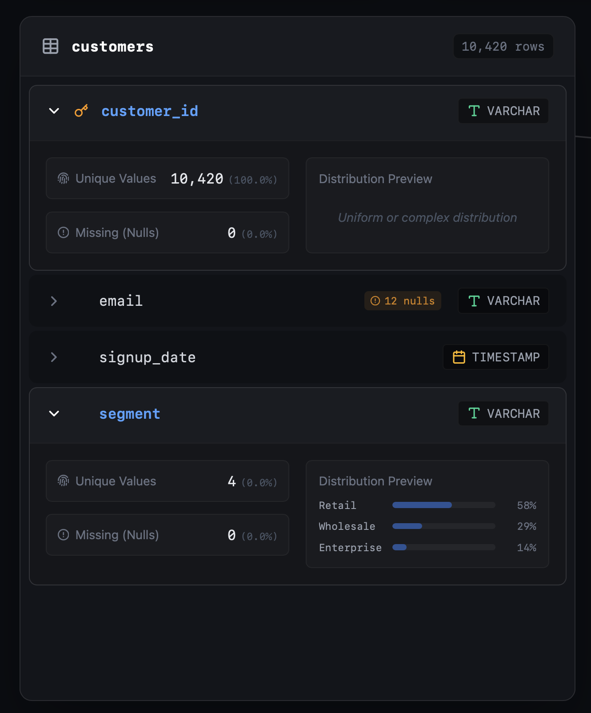
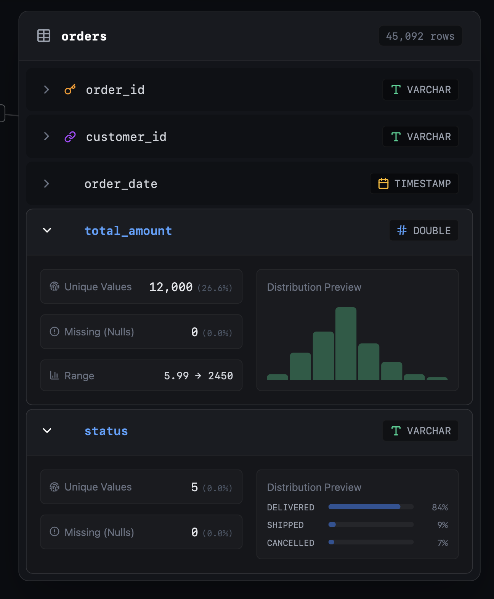
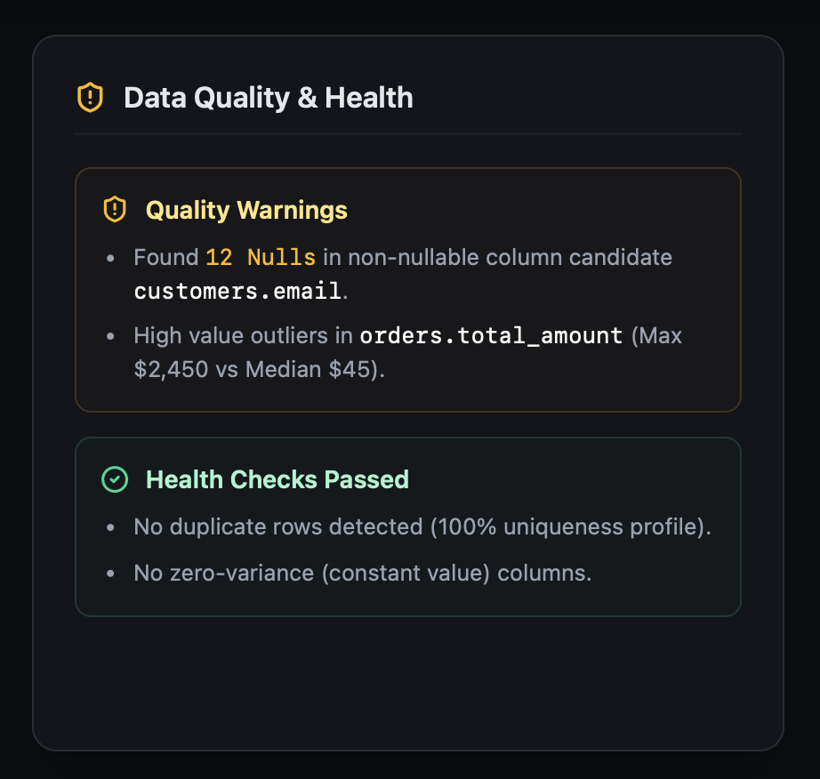
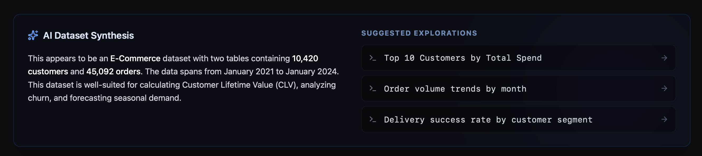
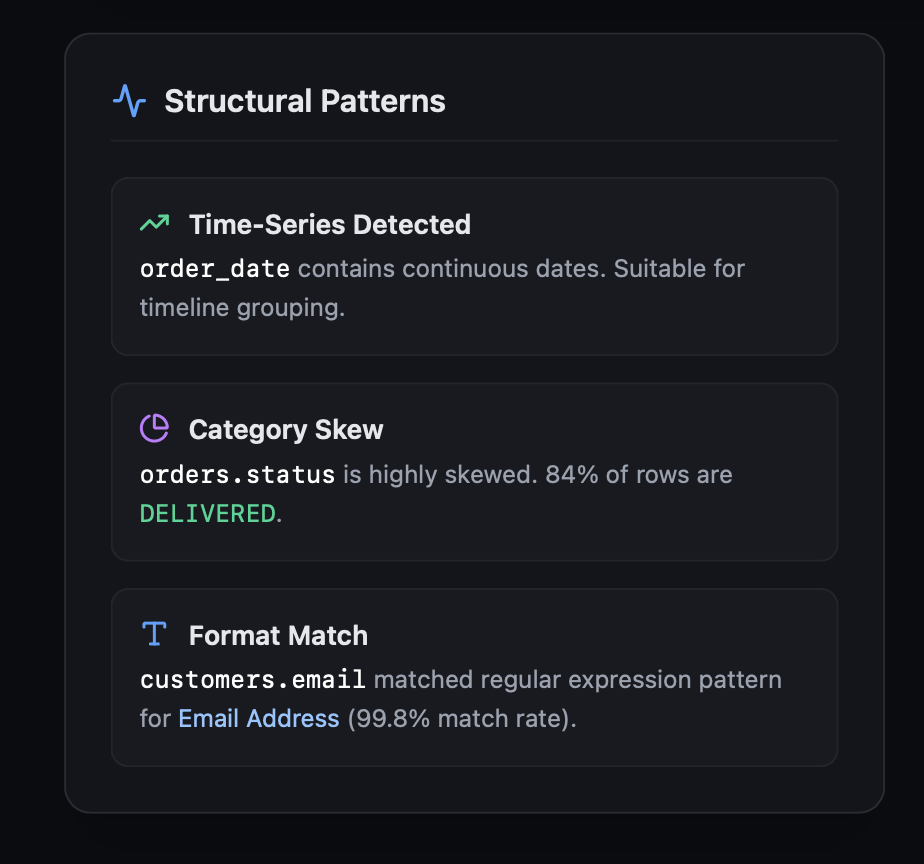
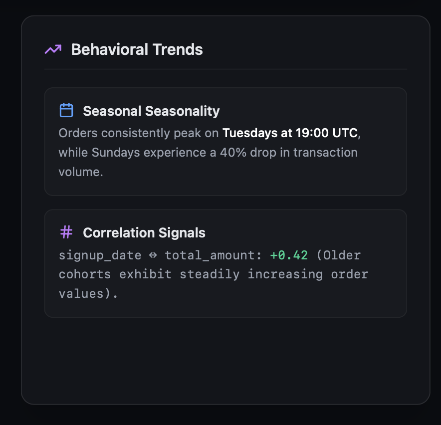

# 14 — The workspace streamline (D73)

**Tier:** v0.70 · **Phases:** S0–S7 (§19) · **Depends on:** v0.69 (the hallmark visual
replication, complete 2026-07-25). Spec of record: master **§13.3** and **§19**'s v0.70
subsection; decision row **D73** (which amends **D71**); the console's module contents are
**§10 Module 2**, unchanged. Locked design system: `.hallmark/design.md` — this tier changes
what the shell *is*, never what it looks like, so every surface it adds inherits that system
rather than negotiating with it.

v0.60 built the Workbench's structure; v0.69 built its visual layer. This tier changes the
shell **after a dataset is loaded** — the explorer rail and the `map · workspace` tab. Act 0 /
Act 1 (welcome, ingest) are **explicitly out of scope**, and the AI pane's *content* is too;
the AI pane is touched only by the resize mechanics every pane now shares and by the run
action added to its per-turn SQL.

**Why this is a decision and not an execution tier.** v0.69 chartered no new decision because
D71 already named the mocks. This one deletes a shipped tab type, adds a shell region, rewires
every generated-SQL affordance in the app, and **reverses three D71 positions** — so it lands
as **D73** rather than as more D71 execution. The three reversals, stated once so no leaf has
to re-derive them:

1. **The bottom inspector's charter.** §13.3 held it as "scent, not dashboard," explicitly
   "never a pedagogical surface," with the "no charts in the inspector" line held through W7.
   A running SQL console with a results grid in that region is a reversal, not an extension.
   The charter now scopes to the drawer's **Info view**, where it still holds in full.
2. **The singleton tab worked example.** §13.3 used "one SQL playground" *as the definition*
   of a singleton tab. Deleting the standalone SQL tab changes the paragraph's own
   illustration. The singleton **model** stands; so does the registry's closedness.
3. **The Settings tab.** §13.3 named a Settings tab (VS Code Settings-editor idiom); the code
   ships `AISettingsPanel` as a modal overlay. D73 resolves the divergence **in favour of what
   is built** — a deliberate reversal, not a discovery.

## The shape, stated once

**One writing surface, one keeping surface.** SQL is typed in exactly one place — the drawer
console. Everything else that *displays* SQL gains a **run action** that sends the query there,
opens the drawer, and executes it **without navigating away from the chart or answer on
screen** — which is the journey the app currently cannot do at all (Copy SQL, navigate away,
paste). Results worth keeping are promoted into **query tabs**: independent, editable,
re-runnable, per-instance, never deduped. Ephemeral goes to the one shared console; deliberate
goes to its own tab.

| Intent | Route | Lands in |
| :--- | :--- | :--- |
| "quick check, don't disturb me" — run SQL you are *looking at* | run action | the console |
| "let's actually explore this" — a chosen suggestion | suggestion click | a new query tab, pre-run |
| "keep this one" — promote a console query | Pin | a new query tab |

## Phases

| Phase | Deliverable | Depends on |
| :--- | :--- | :--- |
| S1 | **Explorer rail reflow:** two-line table rows (name unclamped on line 1, `N rows × N cols · sample` demoted to a muted line beneath), chevron-triggered per-table column disclosure that works for **every** table, Add-data `+` on the rail header | v0.69 |
| S2 | **Data Quality & Health panel:** dataset-scoped warnings + passed checks in the rail's bottom region, empty-state-capable; every finding names a deterministic producer | S1 |
| S3 | **The item-inspector drawer:** Info + console as two user-controlled views of the bottom region, resize/expand-to-viewport, no auto-expand on results, composed cold state, Monaco's lazy boundary moved to the console's first open, viewer-mode absence | v0.69 |
| S4 | **Run from anywhere + the shared guarded run path:** a run action on every surface that displays SQL, and `TransformGuardModal` moved into the one run path every runner calls | S3 |
| S5 | **Query tabs + the registry amendment:** the artifact kind's first live member with both producers; `'sql'` removed from the union, `TAB_TYPE_BY_MODULE` and the palette; Pivot's own results home; Export's entry point to the title bar; settings confirmed as the overlay | S3, S4 |
| S6 | **Map composition:** options strip removed, Suggested Explorations (top 3 + view-more → a pre-run query tab), Structural ‖ Behavioral finding columns at independent heights | S5 |
| S6.9 | **Workspace persistence across refresh:** durable dataset bytes (OPFS-backed DuckDB or byte-staging + re-register) plus registry/UI-state rehydration (`datasets`/`tabs`/`selection`/`relationships`), reconciled against whatever DuckDB actually recovers on load. Four sub-steps: spike → durable row storage → registry persist → rehydration bootstrap. Sequenced before S7 by human instruction, not gated by S0 | none (parallel-safe with S1–S6) |
| S7 | **AI Dataset Synthesis — gated, not scheduled.** Blocked on S0's verdict | S6, **S0** |

**S0 sits ahead of all of them** — [`00-synthesis-and-limits-probe.md`](00-synthesis-and-limits-probe.md),
a D18-style throwaway probe, not a feature. It measures the two things this tier refuses to guess
at: whether a widened synthesis prompt reaches §4's narrative *inside* the ADR-010 honesty seam,
and what a query tab actually costs in memory on real hardware. It gates **S7 entirely** and
**S5's ceiling number only** — S1–S6 are otherwise free to proceed.

**Binding constraint (§19, same as §13.3's and v0.69's):** no `src/` code for a phase starts
until that phase's own leaf doc lands, carrying its own definition of done. Each phase becomes
one leaf in this folder **as it is picked up** — same convention as `../12-workbench/` and
`../13-hallmark-replication/`.

## Reference Design Mocks

The reference UI mocks for this tier live directly in [`reference-images/`](reference-images/) and map to the build phases as follows:

* **S1 (Explorer Rail Reflow):**
  
  
* **S2 (Data Quality & Health panel):**
  
* **S6 / S7 (AI Dataset Synthesis & Suggested Explorations Block):**
  
* **S6 (Structural Patterns & Behavioral Trends Columns):**
  
  

## Cross-cutting contracts every S-leaf inherits

Restated here because each is a place a phase could silently drift.

- **The transform guard is an interception, not an affordance.** `TransformGuardModal` fires
  *between* Run and execution when a statement would mutate a source table. With N independent
  query tabs each running SQL, it **must live in the shared run path** the console and every
  query tab call — never re-mounted per surface. A query tab that runs unguarded is a data-loss
  path the single SQL page never had. This is the one item in the tier that is not optional.
- **Every finding names a producer.** S2's nulls/uniqueness/zero-variance and S6's
  skew/format-match/correlation are computable locally, which is what makes them schedulable.
  A template guess may never be presented as a measured fact.
- **One ranker (D58) survives the strip.** S6 deletes the options strip, but its consumption
  contract is inherited whole: membership and order stay a client-side, subject-scoped filter
  of the dataset-wide `RankedAction[]`, gated actions keep their disabled-with-reason teaching
  copy somewhere reachable, and **SQL-bearing ranked actions route to the console** rather than
  to the deleted page.
- **S5 and S6 are one design change wearing two numbers** where ranked actions are concerned.
  Deleting the SQL tab re-routes every SQL-bearing `RankedAction` (D68e's `duplicates` insight
  opens on the query that found the rows); retiring the strip moves where ranked actions render
  at all. Sequenced apart for buildability, they must be settled **together** in design.
- **The envelope invariant is untouched** (D55/§13.3). Query tabs are app-authored envelopes
  carrying user-typed SQL; nothing here lets a model choose a tab type, identity, or
  initializer. A user running the model's SQL from the audit trail is a person reading text and
  deciding — not the app executing model output.
- **Viewer mode gets Info only, no console** (D62 consumption-only). The drawer must not mount
  a console merely because it is a shell region; a console there would hand a recipient query
  access over a structure report that carries no data to query. The other half needs nothing
  built: `ShareDialog`'s escalation to the full dataset already lands the recipient in an
  ordinary session, which has a console because every ordinary session does.
- **Results never auto-expand the drawer.** A taller-than-drawer result prompts ("N rows —
  click to expand"). Auto-growing a bottom dock over what the user was reading is the failure
  mode this avoids; the accepted trade is that a big result is two gestures away, not zero.
- **Bottom-edge stacking:** status bar → WebLLM dock → drawer → canvas. The drawer expands
  against the canvas above it, never over the dock.
- **Pane mechanics:** every pane drag-resizable, VS-Code split-view style. **v1 is resize +
  collapse**; drag-to-reorder and pinning tables to the top are a later pass, because they add
  persisted per-user layout state. The design language leans on VS Code's chrome as
  *interaction vocabulary* while staying illustrative and approachable — glyphs, spacing, and
  copy stay in DataScope's voice, not VS Code's.
- **Monochrome glyphs only.** The reference screenshots use colour pictographic icons; those
  land as the existing HUD glyph set (`◈ ✦ ◆ ⚙ ✓ ⚠`) or proper SVG, never emoji characters.

## What the SQL tab's deletion takes with it

Deleting the standalone destination is not just dropping a route. Each item below needs an
explicit home or an explicit "dropped" call in S5's leaf — none may be discovered at build time:

- **`TabType`'s `'sql'` member, `TAB_TYPE_BY_MODULE.sql`, and the palette's SQL entry** all go
  or re-point (`types/tabs.ts`, `services/navigation.ts`, `lib/paletteRegistry.ts` — all three
  wired at W7.5).
- **Pivot gets its own results home.** `PivotModule` shares `QueryResultsPanel` with the SQL
  page today. That shared "what a query produced" rendering is deliberate (D49: one execution
  path, not two), so Pivot needs its own home rather than inheriting the deleted page's
  leftovers. J6 — pivot without SQL — is a D53 commitment, not a nice-to-have, and must survive
  this intact.
- **`TransformGuardModal`** → the shared run path (above). Not optional.
- **The export-recipe action** (§12.2), **`AutoChartPanel`** (also used by `InsightFeed`), and
  the **Download-Parquet-on-CTAS** shortcut → the query tabs, and surfaced in the drawer as
  deliberate chrome rather than a button pile.
- **`QuerySuggestions`** → the map's Suggested Explorations (S6), which is the same question as
  the console's cold state asked twice: the console starts on a composed info pane with an
  explicit "open SQL editor" control, not a query list.
- **Monaco's lazy boundary** → the console's first *open*, never the shell's mount. A drawer
  present in every session must not pull the ~2 MB chunk at startup (§15).

Known run-action sources, each needing its affordance wired individually (S4): the four
per-chart-type `GeneratedSql` blocks (`features/charts/{time-series,distribution,categorical,
correlation}/` — Copy-only today), the AI pane's per-turn SQL (§11.1's audit trail), the results
history list (inert display text today), `ColumnCard`/`InsightFeed`'s "Show SQL", and any
`RankedAction` carrying SQL.

## Resolved 2026-07-26 — two gates closed by human call

### The detail ladder — three mechanisms, three levels, each linking to the next

This closes what D73 recorded as a gate on both S1 and S3. The rail's disclosure, the drawer's
Info and the Profile tab are **one escalation, not three answers to one question**:

| Rung | Surface | Weight | Reached by | Sends you to |
| :--- | :--- | :--- | :--- | :--- |
| 1 | **Explorer rail disclosure** | **Lightest — a signpost.** Structure only: column names, key markers, type chips, warning affordance | Deliberate — the user opens a chevron | **Always links out** to the tab view |
| 2 | **Drawer Info** | **Middle — scent.** The W7 inspector's content, unchanged; still no charts | **Ambient** — fills from the selection while the user explores | **Links to the tab view** (new — Info was previously a leaf) |
| 3 | **Tab** | **Full depth**, keep-mounted | Followed from rung 1 or 2, the palette, or a ranked action | Terminal |

**The consequence S1 must honour:** the ideation round's *second* in-rail disclosure level
(per-column unique/missing counts, distribution preview) is **not built**. Those are rung-2/rung-3
content; putting them in the rail is precisely what would have made three surfaces answer one
question. The rail stops at structure and links out.

### Ranked-action routing — by scope, into homes that already exist

No strip replacement is built. Each kind of suggestion goes to the region that already exists for
that scope:

| Suggestion kind | Home | Opens |
| :--- | :--- | :--- |
| Dataset-wide **"go explore this"** | the map's **Suggested Explorations** (top 3 + view-more) | a **query tab**, pre-run |
| Dataset-wide **quality finding carrying a query** (duplicates, null patterns, outliers) | the explorer's **Data Quality & Health panel** — a **run action** on the finding | the **console** |
| **Selection-scoped** finding | the drawer's **Info** view | the **console** (run action), or the tab (rung 2 → 3) |
| **Legal but unranked / gated** | the **command palette**, disabled-with-reason copy intact | its destination, or nothing (reason shown) |

**The quality-panel row is the substantive fix.** D68e's `duplicates` insight "opens on the
answer" — the exact query that found the rows — and with the SQL page deleted it had **no
destination at all**. A run action on the finding is that destination, reusing S4's
run-from-anywhere mechanism rather than being a special case. Four render sites, still **one
ranker** (D58). S5 and S6 still land together because they touch the same wiring.

## Open questions — gates, not deferrals

1. **The synthesis prose (S7's gate) — now S0's, and narrower than it was.** The producer question
   is *not* "does one exist": v0.25 shipped one, already structure-only, opt-in, stateless,
   kill-switched and eval-gated. What the ADR-010 seam deliberately cannot do is invent a claim
   absent from the deterministic slice, and §4's "well-suited for CLV / churn / seasonal demand" is
   exactly that category. **S0 measures whether a widened system prompt reaches it inside the
   seam**, needs a new bounded contract, or is honestly out of reach (→ D65 narration).
   [`00-synthesis-and-limits-probe.md`](00-synthesis-and-limits-probe.md), Probe A.
   **Cloud-leg update (2026-07-26):** the formal method ran — the date-range fix works, but
   the hand audit found one fabrication (a widened headline attributed a Pclass statistic to
   `Survived`), which the doc's own kill criteria treats as disqualifying. Leans D65
   narration, pending the still-open WebLLM leg. Full detail in the probe doc.
2. **The query-tab ceiling (S5) — S0's too.** Horizontal tab-strip scrolling is **decided** and
   ships regardless. The ceiling number and the at-the-ceiling behaviour (refuse vs. evict) are a
   memory measurement on real hardware, and whether the ceiling scales with the device is part of
   what gets measured — not assumed from the WebLLM capability probe, which answers a different
   question. **No leaf doc writes a ceiling number until S0 reports.** Probe B.
3. **Rail disclosure behaviour** — accordion vs. several tables open at once (leaning
   multi-open, all collapsed by default), and whether the rail's bottom panel scrolls
   independently of the table list (leaning yes).
4. **Finding-column stacking priority** below the two-column breakpoint (S6).
5. **Console hand-off seeding** — whether Info's "Open table" pre-seeds a `SELECT *` against the
   table it came from (S3, small).

## Journeys this tier has to carry

Written to test the composition, not to specify it. **J1** (inherited a folder of CSVs) is the
D52/D23 launch story and must still run with no SQL, no AI and no clicks — verdict band →
synthesis → findings → ERD. **J2** ("is this data trustworthy?") is what S2 exists for: today
those findings have no persistent home at all. **J3** ("let me just check something") is what
S3/S4 exist for, and what the app currently cannot do. **J4** ("keep that one") is S5's query
tabs. **J5** (AI answers, user verifies by running the model's SQL) leaves the D55 seam intact —
the *user* runs it, deliberately, as text they read first. **J6** (pivot without SQL, D53) must
survive S5's deletion. **J7** (share the shape, not the data) is settled by the viewer-mode
contract above. **J8** (come back to a table later) is untouched.
